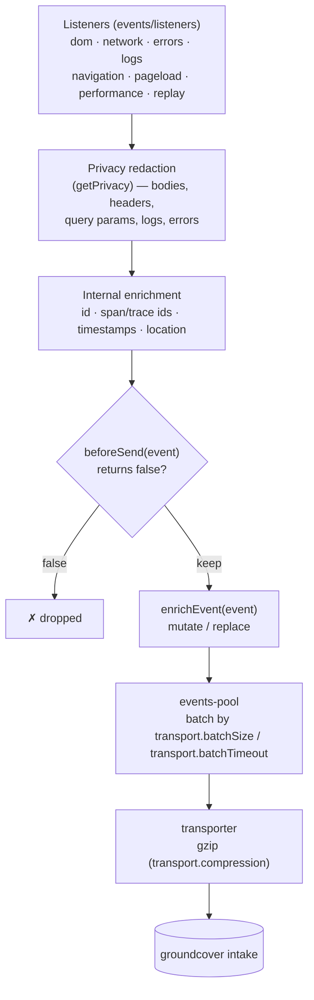

<p align="center">
  
</p>

<h1 align="center">RUM — Browser SDK</h1>

<p align="center">
  <a href="https://www.npmjs.com/package/@groundcover/browser"></a>
  <a href="https://bundlejs.com/?q=@groundcover/browser"></a>
</p>

groundcover’s Real User Monitoring (RUM) SDK captures front-end **performance**, **user
interactions**, **errors**, **logs**, **distributed traces**, and **session replay** from your web
application — with privacy masking **on by default**.

> Session replay is powered by [**rrweb**](https://github.com/rrweb-io/rrweb) under the hood.

See the [groundcover RUM documentation](https://docs.groundcover.com/investigate/real-user-monitoring-rum)
for the full product guide.

---

## Table of contents

- [Quick start](#quick-start)
- [Configuration reference](#configuration-reference)
- [HTTP client integration](#http-client-integration)
- [Privacy & data masking](#privacy--data-masking)
- [Session replay](#session-replay)
- [Architecture](#architecture)
- [Web Worker offloading](#web-worker-offloading)
- [Session lifecycle](#session-lifecycle)
- [Performance considerations](#performance-considerations)
- [API reference](#api-reference)
- [Migrating from 1.x to 2.0.0](#migrating-from-1x-to-200)
- [Migrating to 1.0.0](#migrating-to-100)

---

## Quick start

```bash
npm install @groundcover/browser
```

```ts
import groundcover from "@groundcover/browser";

groundcover.init({
  apiKey: "your-api-key",
  dsn: "your-dsn",
  cluster: "your-cluster",
  appId: "your-app-id",
  environment: "production",
});
```

That single call installs every instrumentation (page loads, DOM interactions, network requests,
errors, console logs, navigation, and performance) and starts sending data. Session replay is the
one exception — it must be started explicitly with
[`startReplayRecording()`](#session-replay). From here you can enrich it:

```ts
// Tie events to a user
groundcover.identifyUser({ id: "u_123", email: "user@example.com", organization: "acme" });

// Capture a handled error
groundcover.captureException(new Error("Checkout failed"), { feature: "checkout" });

// Emit a structured log
groundcover.logger.warn("Payment retry", { provider: "stripe", attempt: 2 });

// Emit a custom business event
groundcover.sendCustomEvent({ event: "plan_upgraded", attributes: { plan: "pro" } });
```

---

## Configuration reference

`init()` takes connection/identity fields at the top level and all behavioral knobs under
`options`, grouped by concern.

The first successful `init()` initializes the SDK. Every later call is silently ignored, even with
a different `appId` or config. Calls made during initialization are also ignored; if initialization
fails, a later call can retry. Use [`updateConfig()`](#updating-config-at-runtime) or the other runtime
APIs for supported changes.

```ts
groundcover.init({
  // ── Connection & identity ──
  apiKey, dsn, cluster, appId,
  environment, namespace, releaseId,
  user, sessionId,

  options: {
    debug,
    sessionSampleRate,
    enabledEvents, excludedUrls,
    sessionMaxDuration,
    beforeSend, enrichEvent,
    privacy:   { /* … */ },
    tracing:   { /* … */ },
    transport: { /* … */ },
    errors:    { /* … */ },
    replay:    { /* … */ },
  },
});
```

### Top-level (connection & identity)

| Field | Type | Required | Description |
|---|---|---|---|
| `apiKey` | `string` | ✅ | Your groundcover RUM API key. |
| `dsn` | `string` | ✅ | RUM intake endpoint. A bare host is upgraded to `https://`. |
| `cluster` | `string` | ✅ | Target groundcover cluster. |
| `appId` | `string` | ✅ | Required application identifier; cannot be empty or whitespace-only. Reported unchanged as `service.name`. |
| `environment` | `string` | — | Deployment environment (e.g. `production`, `staging`). |
| `namespace` | `string` | — | Logical grouping/namespace for the app. |
| `releaseId` | `string` | — | Release/version identifier (e.g. a semver or commit hash). |
| `user` | `Partial<UserIdentifiers>` | — | Identify the user at init (same shape as [`identifyUser`](#identifyuser)). |
| `sessionId` | `string` | — | Use a shared session id — see [micro-frontends](#micro-frontend-session-synchronization). |
| `options` | `Partial<SDKOptions>` | — | Behavioral configuration, below. |

### `options` — top-level knobs

| Option | Type | Default | Description |
|---|---|---|---|
| `debug` | `boolean` | `false` | Verbose SDK console logging. |
| `sessionSampleRate` | `number` | `1` | Fraction of sessions captured (0–1). |
| `enabledEvents` | `Array<…>` | `[]` | Instrumentations to enable. **Empty = all.** Members: `dom`, `network`, `exceptions`, `logs`, `pageload`, `navigation`, `performance`, `replay`. Note: `replay` still requires an explicit [`startReplayRecording()`](#session-replay) call — it never auto-starts. |
| `excludedUrls` | `Array<string \| RegExp>` | — | Network requests matching these are not captured. `data:` and `blob:` URLs are never captured: they are read from memory, not the network. |
| `sessionMaxDuration` | `number` | `4h` | Target max session length in ms (1 min – 8 h). See [session lifecycle](#session-lifecycle). |
| `beforeSend` | `(event) => boolean` | — | Drop gate — return `false` to discard an event. Runs after redaction/enrichment; see [event lifecycle](#architecture). |
| `enrichEvent` | `(event) => event` | — | Mutate/replace an event before batching. Runs right after `beforeSend`; see [event lifecycle](#architecture). |

### `options.privacy`

Drives both replay and non-replay masking. **On by default.** See
[Privacy & data masking](#privacy--data-masking) for the full table.

### `options.tracing`

Distributed-tracing header propagation for outgoing requests.

| Option | Type | Default | Description |
|---|---|---|---|
| `propagationUrls` | `string[]` | `[]` | Request URLs that receive injected tracing headers. Each pattern must match the whole URL; only `*` is a wildcard. A path pattern such as `"/api/*"` matches same-origin requests only. |
| `propagationHeaders` | `string[]` | `[]` | Header names to read/propagate onto traced requests. |
| `traceIdHeaderName` | `string` | `""` | Header carrying the trace id. |
| `spanIdHeaderName` | `string` | `""` | Header carrying the span id. |
| `origin` | `{ name: string; value: string }` | `{ name: "", value: "" }` | Origin tag stamped on injected trace headers. |

```ts
options: {
  tracing: {
    propagationUrls: ["https://api.acme.com/*"],
    traceIdHeaderName: "x-groundcover-trace-id",
    spanIdHeaderName: "x-groundcover-span-id",
  },
}
```

### `options.transport`

Batching and delivery of outgoing events.

| Option | Type | Default | Description |
|---|---|---|---|
| `batchSize` | `number` | `10` | Max events buffered before a batch flushes. |
| `batchTimeout` | `number` | `10000` | Max ms a batch waits before flushing regardless of size. |
| `compression` | `boolean` | `true` | Gzip-compress batches (offloaded to the Web Worker when available). |

### `options.errors`

How errors are reported. From `2.3.0`.

| Option | Type | Default | Description |
|---|---|---|---|
| `deduplication.enabled` | `boolean` | `true` | Merge repeats of the same error within a batch. `false` sends every occurrence. `deduplication: false` is shorthand for `{ enabled: false }`. |

An error loop can send the same exception, or log the same error, thousands of times. With
deduplication on, a repeat of an exception or an error-level log that is still waiting in the current
batch is counted on that event instead of sent again. The event sent is the first occurrence in the
batch, with `error_repeat_count` (exceptions) or `log_repeat_count` (logs) set to how many
occurrences it stands for, itself included. Events without the field stand for one, so the true
count of an error is the sum of the field over its events.

- **The same error** means the same page (the `location` the SDK stamps: path, URL and title), and
  for an exception the same type, message (its first 400 characters, after redaction), handled flag
  and stack trace, that is, thrown through the same code path; for a log, the same message. Other
  attributes and metadata don't count. An uncaught value that isn't an `Error` (a rejected object or
  string, a thrown object) carries no stack from your code, so those group by the value's shape, its
  keys or text, not by where they came from; a value passed to `captureException` keeps your stack.
- **A merged event keeps the first occurrence's context**: its timestamp, ids, metadata and anything
  a hook added. Later occurrences add only to the count. The same error on another page
  is never merged, so each keeps its own event.
- **How much it saves**: at most one event per error per batch. A merged event counts as one toward
  `transport.batchSize`, however often it repeats, so a loop alone doesn't fill a batch: it is sent
  with the batch, when `transport.batchTimeout` passes, other events fill it, or the page is hidden.
  A loop that runs for a minute while nothing else is captured is 6 events at the default 10-second
  `batchTimeout`, however many times it throws.
- **Hooks** still see every occurrence: `beforeSend` and `enrichEvent` run first, an occurrence
  `beforeSend` drops isn't counted, and the count is set on a copy when the batch is sent, so the
  hooks never see `error_repeat_count` or `log_repeat_count`. Which events are the same is decided
  when the SDK builds them, so a hook that rewrites or replaces an event doesn't change how it groups;
  one that changes its `type` sends it on its own.

```ts
options: {
  errors: {
    deduplication: false, // send every occurrence
  },
}
```

An exception thrown before the visitor first interacts with the page is sent when the page is
hidden or closed, even if the page was never on screen; see
[Visits without interaction](#visits-without-interaction).

### `options.replay`

Session-replay recording controls. **This is noise reduction, not privacy** — to mask sensitive
content use [`privacy`](#privacy--data-masking).

| Option | Type | Default | Description |
|---|---|---|---|
| `blockedSelectors` | `string[]` | — | CSS selectors whose elements (and subtrees) are excluded from recording. Useful for noisy extension-injected DOM (e.g. Grammarly). |
| `canvas` | `ReplayCanvasOptions` | off | **Opt-in** capture of `<canvas>`-rendered content (charts, WebGL widgets). Off by default — see [Canvas capture](#canvas-capture-opt-in) for the fields and tradeoffs. |

> ⚠️ Don’t confuse `options.replay.blockedSelectors` (recording noise reduction) with
> `options.privacy.replay.*` (rrweb masking callbacks). They live at different levels and serve
> different purposes.

#### Canvas capture (opt-in)

By default rrweb only serializes the DOM/SVG around a `<canvas>`, so anything **drawn to a canvas**
— chart data series, WebGL scenes — is **not** recorded and replays as an empty frame. Set
`options.replay.canvas.enabled` to capture canvas pixels as periodic image snapshots.

```ts
groundcover.init({
  // …
  options: {
    enabledEvents: ["replay" /* … */],
    replay: {
      canvas: {
        enabled: true,        // default false
        fps: 1,               // default 1, clamped to [1, 15]
        imageType: "image/webp", // default 'image/webp' ('image/jpeg' | 'image/png')
        imageQuality: 0.6,    // default 0.6 (lossy formats only)
      },
    },
  },
});
```

| Field | Type | Default | Maps to rrweb |
|---|---|---|---|
| `enabled` | `boolean` | `false` | `recordCanvas` |
| `fps` | `number` | `1` (clamped `[1, 15]`) | `sampling.canvas` |
| `imageType` | `'image/webp' \| 'image/jpeg' \| 'image/png'` | `'image/webp'` | `dataURLOptions.type` |
| `imageQuality` | `number` (0–1) | `0.6` | `dataURLOptions.quality` |

> ⚠️ **Canvas capture is expensive and off by default for good reason.** Enable it only when you
> knowingly accept the tradeoffs:
> - **Bandwidth** — every snapshot is a serialized image, so replay payloads grow substantially on
>   canvas-heavy pages. Keep `fps` low and prefer lossy `image/webp`/`image/jpeg`.
> - **CPU** — every canvas on the page is re-encoded every `1/fps` seconds, changed or not, on the
>   recorded (end-user) device. `fps` is the main CPU lever.
> - **Privacy** — canvas pixels **bypass `privacy` text/input masking entirely**. Whatever is drawn
>   is captured verbatim; do not enable canvas capture on views that render sensitive data to a
>   canvas.

> **WebGL:** capture is **best-effort and not officially supported** by this option. Snapshotting a
> WebGL/WebGL2 canvas only yields pixels if the page created its context with
> `preserveDrawingBuffer: true`; otherwise frames may come back blank. 2D canvases (the common chart
> case) are captured reliably.

##### Recipes

Canvas capture's cost depends on the page: how many canvases, how big they are, and how often they
redraw. Start from the closest recipe and adjust:

| Page | Config | Why |
|---|---|---|
| Dashboards and charts that redraw every few seconds or on interaction | `{ enabled: true }` | The 1 fps default costs the least CPU, and charts that change slower than once a second send the same bytes at any rate. |
| Animated canvases (live charts, maps, games) | `{ enabled: true, fps: 4, imageQuality: 0.4 }` | Smoother playback. Every changed canvas sends a full image per frame, so bytes grow with `fps` × the number of animated canvases. |
| Constrained bandwidth | `{ enabled: true, imageQuality: 0.3 }` plus `replay.blockedSelectors` | Lower quality shrinks each image; blocked canvases are skipped entirely. |
| CPU-sensitive pages (low-end devices) | `{ enabled: true, imageType: "image/png" }` | PNG encodes much faster than webp but produces about twice the bytes. |

Capture samples each canvas every `1/fps` seconds and drops a frame that's identical to the
previous one, so an unchanged canvas sends nothing between full snapshots. The sampling also sets
the time resolution: a canvas state that lasts less than `1/fps` seconds, such as a brief transition
or a hover highlight, may not appear in the replay. Raise `fps` when those moments matter.

For scale, a dashboard with a handful of canvas charts adds a few hundred KB per minute while the
charts are static and around 1 MB per minute while they redraw. The recorder's CPU cost grows with
`fps` while the bytes stay the same, and PNG costs less CPU than webp at the same rate.

Changing `replay.canvas` (or `replay.blockedSelectors`) via `updateConfig` restarts the active
recording so the new options take effect at rrweb `record()` time. A partial `canvas` update merges
into the current one, so `{ canvas: { fps: 8 } }` keeps capture enabled; pass `enabled: false` to
turn it off.

### Updating config at runtime

`updateConfig` accepts these optional fields: `cluster`, `environment`, `namespace`, `releaseId`,
`dsn`, `apiKey`, `options`, and `user`. `appId` cannot be updated. `sessionId` is not accepted;
use the separate `setSessionId()` API. Nested groups merge one level deep (and `tracing.origin`,
`privacy.replay` and `replay.canvas` one level deeper), so a partial update preserves the other keys in
the group:

```ts
groundcover.updateConfig({
  options: {
    transport: { batchSize: 20 }, // batchTimeout/compression are preserved
    privacy: { level: "mask-all" },
  },
});
```

For `user`, an omitted key leaves the current identity untouched, passing an object merges into it,
and passing `null` clears it (e.g. on logout).

---

## HTTP client integration

The SDK instruments network requests by wrapping the global `fetch` and `XMLHttpRequest` on
`init()`. Most clients are captured automatically, but *how* a client resolves `fetch` decides
whether it gets instrumented.

**Initialize `groundcover.init()` before constructing fetch-based clients.** `init()` replaces
`globalThis.fetch` with an instrumented wrapper. Libraries that capture a reference to
`globalThis.fetch` at construction time — e.g. [`openapi-fetch`](https://openapi-ts.dev/openapi-fetch/)'s
`createClient()`, whose `fetch` option defaults to `globalThis.fetch` — freeze the *native* fetch if
they are built first, so their requests bypass RUM. Two ways to avoid this:

```ts
// 1) Init the SDK before you build the client
groundcover.init({ /* ... */ });
const client = createClient({ baseUrl: "/" });

// 2) Or late-bind fetch so the client resolves the wrapped fetch per request
// (forward both args so method/headers/body/signal from an `init` are preserved)
const client = createClient({
  baseUrl: "/",
  fetch: (input, init) => globalThis.fetch(input, init),
});
```

Option 2 is the robust choice when import order is hard to guarantee: bundlers evaluate a module's
static imports before its body, so a client built at module scope is often constructed *before* your
`init()` call runs.

**XHR-based clients (e.g. axios) are always instrumented** regardless of init order — the SDK patches
`XMLHttpRequest.prototype`, so every request created after `init()` is covered.

**`Request`-object calls are captured.** Clients that call
`fetch(new Request(url, { method, body }))` (openapi-fetch does) carry the method and body on the
`Request` rather than in an `init` argument; the SDK reads the method and the request *body* from
either. Method, URL, headers, status, request body, and response body are recorded. The `Request`
body is read from a clone taken before the request is sent, so the app's copy is never consumed.

Request and response bodies are captured the same way: up to a size cap, with redaction applied
*before* truncation so sensitive keys are always masked. A body larger than the cap is recorded as
`[request body too large]` / `[response body too large]` rather than a truncated fragment — a partial
body can't be parsed for structured redaction, so it is never emitted. Non-text bodies are
placeholdered by content-type (`[binary data]`, `[image data]`, `[pdf data]`, `[form data]`, …), and
a slow or never-closing body read resolves to `[request body unavailable]` /
`[response body unavailable]` so it can never defer the event.

---

## Privacy & data masking

Masking is **on by default** (`privacy.level: 'mask-sensitive'`). A single `level` is the master
switch; finer toggles and hooks refine it.

| `level` | Replay inputs | Replay text | DOM events | Network / logs / errors |
|---|---|---|---|---|
| `mask-sensitive` **(default)** | sensitive masked | `[data-private]` + `maskSelectors` masked | sensitive masked | redacted |
| `mask-all` | masked | masked (`*`) | all masked | redacted |
| `allow` | — | — | — | off (auth headers are still stripped) |

Under `mask-sensitive`, an input/element is masked when it is a `type="password"`, sits under a
`[data-private]` ancestor or a `maskSelectors` match, or has an `id`/`name`/`class`/`aria-label`/
`placeholder` matching a built-in sensitive-key pattern or your `sensitiveKeys`. Non-sensitive inputs
and static page text stay visible; use `[data-private]` / `maskSelectors` to mask static content.

| Option | Type | Default | Description |
|---|---|---|---|
| `level` | `'mask-sensitive' \| 'mask-all' \| 'allow'` | `'mask-sensitive'` | Master masking switch. |
| `maskSelectors` | `string[]` | — | CSS selectors whose text/inputs are always masked (replay + DOM), unless `level: 'allow'`. |
| `maskNetworkBodies` | `boolean` | `true` | Redact network request/response bodies. |
| `maskNetworkQueryParams` | `boolean` | `true` | Redact URL query params. |
| `maskLogs` | `boolean` | `true` | Redact console/log messages and attributes. |
| `maskErrors` | `boolean` | `true` | Redact error messages and metadata. Stack frames are sent as they are. |
| `sensitiveKeys` | `string[]` | — | Extra case-insensitive key substrings treated as sensitive, merged with built-ins. |
| `redact` | `(field) => value \| undefined` | — | Per-leaf custom redactor for non-replay events. Return `undefined` to defer to the SDK default. |
| `replay.maskTextFn` | `(text, el) => string` | — | rrweb `maskTextFn` pass-through (replay only). |
| `replay.maskInputFn` | `(text, el) => string` | — | rrweb `maskInputFn` pass-through (replay only). |

```ts
options: {
  privacy: {
    level: "mask-sensitive",
    maskSelectors: [".pii", "#ssn"],
    sensitiveKeys: ["account_no"],
  },
}
```

#### Built-in sensitive patterns

These are always treated as sensitive (case-insensitive); your `sensitiveKeys` are merged in on top.

- **Key substrings** — matched as a substring of a body/query key or a DOM element attribute
  (`id`/`name`/`class`/`aria-label`/`placeholder`):
  `token`, `secret`, `passwd`, `password`, `api_key`, `access_key`, `write_key`, `auth`, `bearer`,
  `credential`, `cvv`, `ssn`, `credit_card`, `card_number`. For `api_key`, `access_key`,
  `write_key`, `credit_card` and `card_number` the separator is flexible — absent, `_` or `-` all
  match, so `apikey`, `api_key` and `api-key` are equivalent. The rest match literally.
- **Request/response headers** — always stripped regardless of `level`: `authorization`, `cookie`,
  `set-cookie`, plus any header name containing `token`, `key`, `secret`, `passwd`, `password`,
  `auth`, `bearer`, or `credential`.
- **Query / form param names** — matched as a whole key (not inside JSON bodies), for OAuth-style
  callbacks: `code`, `state`, `session_state`, `id_token`, `access_token`, `refresh_token`, `token`.

To opt out entirely: `privacy: { level: "allow" }`.

---

## Session replay

Replay is recorded with [**rrweb**](https://github.com/rrweb-io/rrweb). The SDK wires rrweb’s
record-time masking from your [`privacy`](#privacy--data-masking) config:

- `privacy.level` / `privacy.maskSelectors` → rrweb `maskAllInputs` + `maskTextSelector`
- `privacy.replay.maskTextFn` / `maskInputFn` → rrweb `maskTextFn` / `maskInputFn`
- `options.replay.blockedSelectors` → rrweb `blockSelector` (noise reduction)
- `options.replay.canvas` → rrweb `recordCanvas` + `sampling.canvas` + `dataURLOptions` (opt-in, off by default — see [Canvas capture](#canvas-capture-opt-in))

Replay recording does **not** start automatically — even when `replay` is in `enabledEvents`. You
must start it explicitly (e.g. after obtaining user consent):

```ts
groundcover.startReplayRecording();
groundcover.stopReplayRecording();
```

> rrweb mask options are fixed at `record()` time. Changing privacy config at runtime via
> `updateConfig` automatically **restarts** the active recording so the new masking applies.

---

## Architecture

Every captured event flows through one pipeline from instrumentation to intake. The two public
hooks — **`beforeSend`** (drop gate) and **`enrichEvent`** (transform) — run in the events pool,
*after* privacy redaction and internal enrichment, so they always see the final, already-redacted
event.



**Event lifecycle (in order):**

1. **Capture** — a listener builds the raw event.
2. **Redact** — sensitive payload is masked per the resolved [`privacy`](#privacy--data-masking) config.
3. **Enrich (internal)** — the SDK stamps id / span & trace ids / timestamps / `location` (location query params are redacted here too).
4. **`beforeSend(event)`** — your hook; return `false` to **drop** the event. Receives the fully-redacted, enriched event.
5. **`enrichEvent(event)`** — your hook; mutate or replace the event before it’s buffered.
6. **Deduplicate (exceptions and error-level logs)** — a repeat of one already in the current batch is counted instead of buffered again; see [`options.errors`](#optionserrors).
7. **Batch** — buffered in the events pool, flushed at `transport.batchSize` (a merged error counts once) or `transport.batchTimeout`.
8. **Send** — gzipped (`transport.compression`) and delivered to intake.

Supporting pieces:

- **`instrumentation-manager`** installs listeners per `enabledEvents`.
- **`config-manager`** holds the resolved `SDKConfig` and a memoized `getPrivacy()` read by every
  listener; runtime `updateConfig` invalidates the privacy memo.
- **`session-manager`** owns the session lifecycle — see [below](#session-lifecycle).
- **`worker`** offloads replay packing + gzip off the main thread.

> Note: `beforeSend`/`enrichEvent` do **not** see explicitly-sent `sendCustomEvent` payloads pre-redacted —
> those are deliberately-provided and are not auto-redacted; scrub them yourself or via `enrichEvent`.

---

## Web Worker offloading

The SDK spawns a dedicated Web Worker on init and offloads CPU-heavy work — session-replay event
packing and outgoing-batch gzip — off the main thread so it doesn’t compete with your page’s UI
work.

The worker is bundled inline (no extra files to host) and spawned from a `blob:` URL. On
environments that don’t permit blob-sourced workers — strict Content Security Policy without
`worker-src 'self' blob:`, sandboxed iframes, SSR — the SDK silently falls back to the main-thread
implementation. Behavior, wire format, and the public API are identical in both modes.

---

## Session lifecycle

`sessionMaxDuration` sets a **target** maximum wall-clock session length (default 4 hours; must be
between 1 minute and 8 hours).

It is enforced **lazily, on activity — not by a background timer**, so it is **not a hard upper
bound**. Once the cap has elapsed, the *next* user/business event (click, navigation, log, custom,
network, exception, …) flushes pending events under the current session id, mints a fresh id, and
resumes replay recording if it had been active.

Because rotation is activity-gated, a session that goes idle keeps its id past the cap until the
next qualifying event:

- A dormant or backgrounded tab that produces no further events stays on the same session id — by
  design, so the SDK doesn’t mint “phantom” sessions for tabs nobody is using.
- **Session-replay batches don’t count as activity** (rrweb emits a snapshot heartbeat every 5
  minutes regardless of interaction), so a tab that’s only recording replay won’t rotate on that alone. It’s
  ultimately bounded by the 30-minute replay-inactivity stop, not by this cap.

Sessions are also bounded by a 30-minute inactivity gap, enforced the same lazy way. The flush is
best-effort and the rotation always proceeds regardless of delivery success. Invalid values fall
back to the default with a `console.warn`.

**When a rotated session starts.** A new session's `session_start_time` is taken from the earliest
event that belongs to it — normally the very event that triggered the rotation — rather than from the
instant the rotation ran. The two differ by the few milliseconds the rotation itself takes, and using
the later value would report a session as starting *after* an event it carries, which reads downstream
as a negative duration. Candidates are only accepted if they are no older than one inactivity window
and not in the future, so a `beforeSend`/`enrichEvent` hook returning a wildly skewed timestamp cannot
move a session's start (the same value also drives the cap and inactivity clocks).

This assumes a fully configured SDK, which means `cluster` supplied at `init` — it is required, and
every other guarantee here is stated for that case.

### Visits without interaction

The SDK sends nothing for a visit until the user first interacts with the page (pointer, key, scroll
or touch input). When the page is hidden or closed before that (the visitor navigates away,
reloads, closes the tab or switches to another), the visit is sent, with everything the SDK held for
it (page load, network requests, logs, errors), if either:

- **The page was visible in the last 30 minutes**, so the visitor could see it. For example, a
  page that loads slowly and is reloaded or left before it's used, or a tab the visitor switched
  away from.
- **It caught a real exception**: an uncaught error, an unhandled rejection or a `captureException`
  call, even on a page that was never on screen. Error-level logs don't count, and neither do
  browser messages that say nothing about the app (`Script error.` and the ResizeObserver loop
  notices); those are still sent with a visit that goes for another reason.

Otherwise the visit is dropped, so tabs opened in the background and closed unseen, pages that
reload themselves in a background tab, and prerendered pages nobody opened don't become sessions.

- **Nothing is sent while the page is open.** Neither reason counts as an interaction: if the
  visitor comes back, the rest of the visit is held until they interact, and each time the page is
  hidden again what arrived since is sent. If that first interaction comes more than 30 minutes
  after the visit began, it starts a new session (the inactivity gap), and what was held since the
  page was hidden is dropped.
- **A tab left in the background for more than 30 minutes** sends nothing more when it's closed,
  unless it catches a real exception: what it did in the background (polling, logs) isn't part of
  what the visitor saw.
- **"Visible"** means the active tab of a window that isn't minimized. It doesn't mean someone was
  looking: a visit that was visible with nobody there is sent too.
- **Only the session the visit started with.** A session that begins later in a tab nobody has
  touched (after `sessionMaxDuration`) is background traffic, and is still dropped.
- **`setSessionId()` before the first interaction** still drops what the visit held. The session it
  sets takes the place of the one the visit started with, and is sent by the same rules.
- **Bots and headless browsers** report their pages as visible, so a crawler that closes its pages
  normally appears as a session. Filter them with `beforeSend` if you need to.

### Micro-frontend session synchronization

Initialize the shared SDK once in the shell with a shared `sessionId` so the micro-frontends report
under one session. Each micro-frontend uses that same SDK to capture events:

```ts
// Shell
const sharedSessionId = "session-12345";
groundcover.init({ apiKey, dsn, cluster, appId: "your-app-id", sessionId: sharedSessionId });

// Micro-frontend using the shared SDK
groundcover.sendCustomEvent({ event: "checkout_opened", attributes: { cartId: "cart-123" } });
```

If you need to explicitly rebind the shared SDK to another session, use `setSessionId()`.

---

## Performance considerations

- **Batching & compression** — events are buffered (`transport.batchSize` / `transport.batchTimeout`) and
  gzipped (`transport.compression`) to minimize request count and payload size.
- **Web Worker offload** — replay packing and gzip run off the main thread (see above).
- **Sampling** — use `sessionSampleRate` to select whole sessions. Events within selected
  sessions are not randomly sampled; enabled-event settings, filtering, and privacy controls still apply.
- **Scope what you capture** — drop noisy endpoints with `excludedUrls`, and disable unused
  instrumentations via `enabledEvents`.
- **Lazy session rotation** — no background timers; rotation work happens only on real activity.
- **Bundle size** — ships ESM + CJS with built-in types; the published bundle is size-budgeted in
  CI.

---

## API reference

All methods are available on the default export and on `window.groundcover`.

| Method | Description |
|---|---|
| `init(config)` | Initialize the SDK and install instrumentation once; calls after successful initialization are ignored. |
| `identifyUser(user)` | Attach user identity to subsequent events. |
| `sendCustomEvent({ event, attributes })` | Emit a custom business event. |
| `captureException(error, metadata?)` | Capture a handled error (any value) with optional context. |
| `logger.{log,info,warn,error,debug,trace}(message, attributes?)` | Structured logging (see below). |
| `updateConfig({ options?, user?, … })` | Update config at runtime (merges nested groups one level deep). |
| `startNavigation(metadata)` / `endNavigation(metadata)` | Manual navigation spans (when `navigation` isn’t auto-tracked). |
| `getSessionId()` / `setSessionId(id?)` | Read / override the current session id. |
| `startReplayRecording()` / `stopReplayRecording()` | Manually control session replay. |

### Structured logs

`groundcover.logger` has one method per level; the second argument is the attributes object.
Nested objects are flattened to dotted keys:

```ts
groundcover.logger.warn("Checkout failed", {
  orderId: "ord_42",
  cart: { items: 3, total: 99.99 }, // → cart.items, cart.total
});
```

The SDK also auto-captures `console.*` calls; when any argument is a plain object, its keys are
promoted to structured log attributes. Reserved keys (`message`, `level`, `location`) are always
set by the SDK and can’t be overridden.

### `identifyUser`

```ts
groundcover.identifyUser({
  id: "u_123",
  email: "user@example.com",
  organization: "acme",
});
```

### `captureException`

```ts
groundcover.captureException(new Error("Payment failed"), {
  userId: "123",
  feature: "checkout",
});
```

`captureException` accepts any value, not only an `Error`. A string or number becomes the message.
An object is described by its shape, never its values, so captures of the same kind group as one
issue: `Object captured as exception with keys: code, reason`, the class name for a class instance
(`Response captured as exception`), or an item count for an array. The value itself is sent in
`error_metadata.captured_value` as JSON, redacted field by field and cut at 10,000 characters. An
object with a string `message` keeps its own name, message and stack, and a DOM Event is described
by its type and target (`Event captured as exception (type=error, target=img)`):

```ts
groundcover.captureException("Payment failed");
groundcover.captureException({ code: 500, reason: "timeout" });
```

Pass an `Error` when you can: a value that isn't one carries no stack trace of its own, so the
reported stack starts inside the SDK.

### Errors hidden as "Script error."

From `2.3.1`. Browsers hide the details of an error that comes from a script served from another
origin: the page's `error` event carries only `"Script error."`, with no error, file or stack, so the
SDK has nothing to report. Chrome and Firefox show the error in full when the script is loaded with
`crossorigin="anonymous"` and served with CORS headers. Safari, and every browser on iOS, still hides
an error thrown inside a `setTimeout`, `setInterval`, `requestAnimationFrame` or event-listener
callback from such a script, and an error passed to `reportError()`. Errors thrown while the script
first runs, and unhandled promise rejections, arrive in full.

So the SDK runs each callback your code passes to those four functions inside its own try/catch, and
notes each value passed to `reportError`. When a callback throws, the SDK notes the error and throws
it again unchanged, then reports it, with its real type, message and stack, when the browser's
`"Script error."` event arrives. A browser that shows the error in full reports it as it always did,
and an error is never sent twice. This is part of the `exceptions` listener.

- **Errors from third-party scripts are left out.** Every browser hides the errors of a script from
  another origin loaded without `crossorigin`, such as a widget, an ad or a tag manager. The SDK's
  try/catch sees them anyway, so it drops an error when every frame of its stack is in such a script,
  recognised by its `<script>` tag. An error with your own code anywhere in its stack is reported.
  Some still get through: a script that removes its tag after it runs, a script whose address
  redirects (the stack shows the final address, the tag the first), and code named with
  `//# sourceURL`. An error your code triggers by calling into such a script is reported, except
  when your frames are missing from its stack, as before `2.3.1`: when the script's own frames fill
  the stack the browser keeps (Chrome keeps 10), or on Safari, which leaves out the frame of a
  callback that ends by returning the call, such as `() => widget.open()`.
- **Load your own scripts with `crossorigin`.** The SDK can't tell your scripts from a third party's,
  so if your bundles come from another origin, such as a CDN or a `static.` subdomain, without
  `crossorigin`, their errors are left out the same way, in every browser. Add
  `crossorigin="anonymous"` to their `<script>` tags and serve them with an
  `Access-Control-Allow-Origin` header. Chrome and Firefox then show their other errors in full too.
- **Start the SDK before your app renders.** Only callbacks registered after `init` are wrapped.
  Listeners added before it (such as the ones your framework adds when it first renders) and a copy
  of `setTimeout` saved before it stay unwrapped, so their errors stay hidden on Safari. Callbacks
  registered another way, such as an `onclick` property or a `MutationObserver`, aren't wrapped.
- **React 19** reports the errors it catches in event handlers and rendering through `reportError`,
  which it looks up when `react-dom` loads. For Safari to report them, `init` must run before
  `react-dom` loads: call it in a module imported before `react-dom`.

  ```ts
  // main.tsx
  import "./groundcover"; // calls groundcover.init(...)
  import { createRoot } from "react-dom/client";
  ```

  Frameworks that load `react-dom` before your code, such as Next.js, leave no such place, so on
  Safari those errors stay hidden. Rendering errors can still be reported through React's root
  options, for example `onUncaughtError: (error) => groundcover.captureException(error)` where you
  create the root; event-handler errors have no such hook.

- **Listeners behave as before.** Adding the same listener twice registers it once, and
  `removeEventListener` removes it. A listener added before `init` and again after it stays
  registered once, with the second call's options, and runs after the target's other listeners.
  After the SDK shuts down, `addEventListener` and `removeEventListener` keep its layer, so a
  listener added while it ran can still be removed; new listeners are then added unwrapped.
- **What other error handlers on the page see.** They get the error as the SDK rethrows it: the same
  error object and stack, but the event's file, line and column are the SDK's rather than where your
  code threw. Because the rethrow comes from the SDK's script, they also see the callback errors of
  third-party scripts in full instead of `"Script error."`. On Safari, if the SDK is served from a
  different origin than your page, they see `"Script error."` for errors from your own callbacks
  too; the SDK still reports those.

---

## Migrating from 1.x to 2.0.0

`2.0.0` removes event-level sampling and makes browser application identity fixed after the first
successful initialization. These are breaking changes; review your initialization and runtime
updates before upgrading:

```bash
npm install @groundcover/browser@^2.0.0
```

| Change | Migration |
|---|---|
| `options.eventSampleRate` is removed | Delete it from initialization and runtime updates. Choose `options.sessionSampleRate` explicitly if you need to limit capture volume. |
| `appId` is required and cannot be blank | Supply a non-empty, non-whitespace string at initialization. Its value is preserved exactly. |
| Each SDK instance initializes once | Initialize in your application's bootstrap code. Use runtime APIs instead of calling `init()` again. |
| `appId` cannot be updated | Exclude it from `updateConfig()`, including when spreading an initialization config. Its presence rejects the entire update, even if its value is unchanged or `undefined`. |

### Why event-level sampling was removed

Randomly dropping individual events leaves gaps in user journeys and can distort funnel analysis.
The SDK now uses `sessionSampleRate` to select sessions without randomly dropping individual events
within them. Enabled-event settings, filtering, and privacy controls still apply; session replay
still requires an explicit start.

> **Volume warning:** If you previously set `eventSampleRate` below `1`, upgrading can increase event
> volume. The removed option has no effect: passing it warns and strips it from stored configuration.
> `sessionSampleRate` is not a rename or an equivalent numeric replacement: `0.1` selects roughly 10%
> of sessions, rather than sampling 10% of events within sessions. Rates are never automatically
> converted. If event sampling was left at its default of `1`, this removal does not increase capture
> through sampling alone.

For example, if you deliberately choose to capture 10% of sessions:

```ts
groundcover.init({
  apiKey, dsn, cluster,
  appId: "checkout",
  options: { sessionSampleRate: 0.1 },
});
```

### Initialize once; update supported fields explicitly

Missing, non-string, or blank `appId` values produce a warning and leave the SDK uninitialized.
After correcting the input, call `init()` again. A failed initialization also permits an explicit
retry; calls during initialization or after success are silently ignored, regardless of `appId`.

Do not spread your initialization config into a runtime update:

```ts
// Pass only the fields you intend to change, without appId.
groundcover.updateConfig({ dsn: newDsn, apiKey: newApiKey, cluster: newCluster });
groundcover.identifyUser({ id: "user-123" });
await groundcover.setSessionId("shared-session-id");
```

An update containing `appId` warns and applies **none** of its fields. Use `identifyUser()` for user
identity and `setSessionId()` for session identity; neither changes the application identity.
For micro-frontends, initialize the shared SDK once in the shell and reuse it in each frontend.

---

## Migrating to 1.0.0

`1.0.0` restructures `options` by concern (a clean break from `0.x`) and removes the deprecated
masking flags. Update your config as follows:

| `0.x` | `1.0.0` |
|---|---|
| `environment` *(duplicated in `options`)* | top-level `environment` only |
| `userIdentifier` | `user` |
| `options.sessionReplay.blockedSelectors` | `options.replay.blockedSelectors` |
| `options.tracePropagationUrls` | `options.tracing.propagationUrls` |
| `options.tracePropagationHeaders` | `options.tracing.propagationHeaders` |
| `options.tracePropagationTraceIdHeaderName` | `options.tracing.traceIdHeaderName` |
| `options.tracePropagationSpanIdHeaderName` | `options.tracing.spanIdHeaderName` |
| `options.traceOrigin` | `options.tracing.origin` |
| `options.batchSize` / `options.batchTimeout` | `options.transport.batchSize` / `options.transport.batchTimeout` |
| `options.enableCompression` | `options.transport.compression` |
| `options.enableMasking: true` *(removed — ignored)* | set `options.privacy.level: 'mask-all'` |
| `options.enableMasking: false` *(removed — ignored)* | set `options.privacy.level: 'allow'` |
| `options.maskFields` *(removed — ignored)* | set `options.privacy.maskSelectors` / `options.privacy.sensitiveKeys` |

> ⚠️ The removed masking flags are **ignored, not auto-mapped** — passing `enableMasking` /
> `maskFields` logs a `console.warn` and has **no effect**. You must set the corresponding `privacy`
> option yourself (right-hand column). Masking remains **on by default** (`mask-sensitive`); if you
> previously relied on masking being off, set `privacy: { level: 'allow' }` explicitly.
