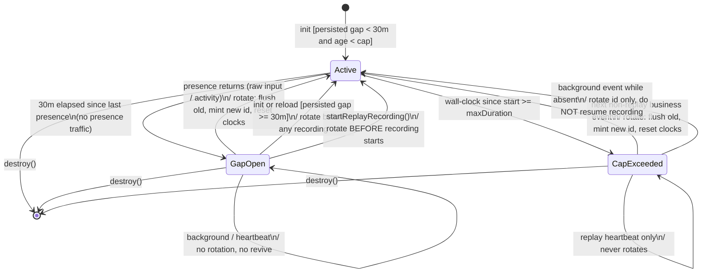

# Session Lifecycle & Replay Recording — Desired Behavior (Source of Truth)

> This document is an **independent specification** of the intended behavior of the RUM
> SDK's session-lifecycle and session-replay state machine. It describes that behavior on
> its own terms — **not** by reading the implementation. The implementation and its tests
> are checked against it.

---

## 1. Vocabulary & Core State

### Session state
- **active** — session id is current, no gap elapsed, max-duration not exceeded.
- **gap-open-not-rotated** — ≥30 min have elapsed since the last presence signal. The
  session has *conceptually ended* at the last activity, but rotation has not been
  performed yet (lazy: we wait for the next presence or init/reload).
- **cap-exceeded-not-rotated** — wall-clock since session start ≥ max duration (default
  4h). The session has *conceptually ended* at the cap, but rotation has not yet fired
  (waits for the next non-replay business event or raw-input presence signal).

> Note: gap-open and cap-exceeded are **conceptual** end-states pending a *trigger* to
> actually perform the rotation. Both are "stale session" states: no replay frame and no
> event may be flushed under the OLD id without first performing the rotation.

### Replay state
- **recording** — rrweb actively capturing; `replayDesired = true` and user present.
- **paused-by-idle** — rrweb stopped because the 30-min idle pause fired; `replayDesired`
  remains **true**. Resumes when presence returns.
- **stopped-by-app** — `replayDesired = false` because the app called
  `stopReplayRecording()` (or never started). Stays stopped across rotations/presence
  until `startReplayRecording()` is called.
- **never-started** — initial state; equivalent to `replayDesired = false` until the app
  starts it. (Distinguished from stopped-by-app only for narration; behaves identically.)

### Derived rule
```
recordingActive  ==  replayDesired  AND  userPresent
```
`replayDesired` is mutated **only** by the public API (`startReplayRecording` → true,
`stopReplayRecording` → false). The idle pause never touches `replayDesired`.

### Signals
| Signal | Presence? | Can rotate on gap? | Can rotate on cap? |
|---|---|---|---|
| raw user input (pointerdown/keydown/scroll/touchstart/mousemove) | yes | yes (on return) | yes (every presence signal checks the cap) |
| SDK activity event (`dom.event`: click, change, keydown, select, submit) | yes | yes (on return) | yes (it's a business event) |
| non-presence event (navigation, pageload, custom, network, performance, log, exception) | no | **no** | yes (bookkeeping) |
| replay heartbeat | no | **no** | **no** |
| 30-min idle timer fires | n/a | no (pauses only) | no |
| `startReplayRecording()` | no (programmatic) | yes (must rotate stale before recording) | n/a |
| `stopReplayRecording()` | no | no | no |
| SDK init / reload (persisted gap) | n/a | yes if persisted gap ≥30min | yes if persisted age ≥cap |
| max-duration cap reached | n/a | n/a | yes (on next non-replay event or raw-input presence) |
| `destroy()` | n/a | no (tears down) | no |

---

## 2. State Diagrams (Mermaid)

### 2.1 Session lifecycle



> A session can be simultaneously gap-open and cap-exceeded. Whichever trigger fires
> first performs the single rotation; the rotation resets both clocks (new start time,
> new last-presence baseline), so the other condition is cleared by the same rotation.

### 2.2 Replay recording state

```mermaid
stateDiagram-v2
    [*] --> NeverStarted

    NeverStarted --> Recording: startReplayRecording()\n[rotate stale first] / replayDesired=true, present assumed/seeded
    StoppedByApp --> Recording: startReplayRecording()\n[rotate stale first] / replayDesired=true

    Recording --> PausedByIdle: 30m idle timer fires\n/ stop rrweb, flush final batch under OLD id, replayDesired UNCHANGED
    Recording --> StoppedByApp: stopReplayRecording()\n/ replayDesired=false, stop rrweb, flush under current id
    Recording --> Recording: presence / heartbeat / background\n(rotation may re-attach under NEW id)

    PausedByIdle --> Recording: presence returns [replayDesired still true]\n/ rotate stale, resume rrweb under NEW id
    PausedByIdle --> StoppedByApp: stopReplayRecording()\n/ replayDesired=false (stays stopped)
    PausedByIdle --> PausedByIdle: background / heartbeat / cap-rotation\n/ stays paused (no revive without presence)

    StoppedByApp --> StoppedByApp: presence / idle / rotation\n/ replayDesired stays false; never auto-resumes

    Recording --> [*]: destroy()
    PausedByIdle --> [*]: destroy()
    StoppedByApp --> [*]: destroy()
    NeverStarted --> [*]: destroy()
```

### 2.3 Programmatic-start lease (fresh ~30-min lease, not indefinite)

```mermaid
stateDiagram-v2
    [*] --> Idle: startReplayRecording() into idle tab
    Idle --> Recording: rotate stale if gap open\n/ seed last-presence = now, start rrweb under NEW id
    Recording --> PausedByIdle: ~30m with NO real input\n/ pause (lease expired)
    Recording --> Leased: real user input arrives within lease\n/ extend lease, keep recording
    Leased --> Recording: continues; lease refreshed on each presence
    PausedByIdle --> Recording: later presence [still desired]\n/ rotate, resume under NEW id
```



---

## 3. Truth Table (state × signal → outcome)

Legend: **Rotate?** = does session id change. **Replay action** = effect on recording.
**Resulting frames** = which session id newly captured/flushed replay frames land under.

### 3.1 Session = active

| Replay state | Signal | Rotate? | Replay action | Resulting frames |
|---|---|---|---|---|
| recording | raw input (throttled-allowed) | no | keep recording; reconcile presence; refresh last-presence | current id |
| recording | raw input (within throttle window) | no | no reconcile (throttled); keep recording | current id |
| recording | SDK activity event | no | keep recording; "quiet poke" presence (consumes one reconcile, no double) | current id |
| recording | background / non-presence | no | keep recording (background is not presence) | current id |
| recording | replay heartbeat | no | keep recording; never affects session | current id |
| recording | 30m idle timer fires | no | **pause** (stop rrweb, flush final batch); `replayDesired` unchanged | current id (final flush) |
| recording | startReplayRecording() | no | no-op (already recording & desired) | current id |
| recording | stopReplayRecording() | no | stop rrweb, flush; `replayDesired=false` | current id |
| recording | cap reached (then non-replay event) | **yes** | stop→flush old, mint new, resume under new | NEW id |
| recording | destroy() | no | stop rrweb, stop timers, clear state | none |
| paused-by-idle | raw input / activity (presence returns) | **yes** (gap open) | rotate stale, then resume rrweb | NEW id |
| paused-by-idle | background / non-presence | no | stay paused (no revive) | none |
| paused-by-idle | replay heartbeat | no | stay paused | none |
| paused-by-idle | startReplayRecording() | maybe (rotate if gap) | already desired; if gap open rotate then resume | NEW id |
| paused-by-idle | stopReplayRecording() | no | `replayDesired=false`; stays stopped | none |
| stopped-by-app | any presence / idle / background / heartbeat | no | stays stopped; never auto-resumes | none |
| stopped-by-app | startReplayRecording() | rotate if stale gap | `replayDesired=true`, rotate stale first, start | NEW id (or current if fresh) |
| never-started | startReplayRecording() | rotate if stale gap | `replayDesired=true`, seed presence, start | NEW id (or current if fresh) |
| never-started | 30m idle timer fires | no | **no-op** (nothing recording → no pause, no rotation) | none |

### 3.2 Session = gap-open-not-rotated (≥30m since presence; rotation pending)

| Replay state | Signal | Rotate? | Replay action | Resulting frames |
|---|---|---|---|---|
| any | background / non-presence event | **no** | no rotation; **no revive** (avoids phantom sessions in idle polling tabs) | none |
| any | replay heartbeat | **no** | never rotates; if paused stays paused | none |
| paused-by-idle | raw input returns (scroll/pointerdown) | **yes** | rotate (flush old, mint new), resume rrweb under new | NEW id |
| paused-by-idle | SDK activity event returns | **yes** | rotate, resume under new (quiet-poke presence) | NEW id |
| recording (e.g. programmatic start happened but gap still open) | presence returns | **yes** | rotate; recording continues under new id | NEW id |
| stopped-by-app | presence returns | **yes** (session) | rotate session; recording stays stopped (`replayDesired=false`) | none |
| never-started | presence returns | **yes** | rotate; no recording (not desired) | none |
| any | startReplayRecording() | **yes** | **rotate stale BEFORE recording**; then `replayDesired=true`, start under new | NEW id |
| any | stopReplayRecording() | no | `replayDesired=false`; no session rotation (no presence) | none |
| any | init / reload (persisted gap ≥30m) | **yes** | rotate at startup before recording; start clean | NEW id |
| any | destroy() | no | tear down; clear gap state | none |

### 3.3 Session = cap-exceeded-not-rotated (wall-clock ≥ maxDuration; rotation pending)

| Replay state | Signal | Rotate? | Replay action | Resulting frames |
|---|---|---|---|---|
| recording | SDK activity / raw-input-driven business event | **yes** | stop→flush old, mint new, **resume** under new (present) | NEW id |
| recording | background / non-presence event (user present) | **yes** | rotate id (bookkeeping); recording continues/resumes under new | NEW id |
| paused-by-idle | background event while user ABSENT | **yes (id only)** | rotate id; **do NOT resume recording** (no presence) | none |
| recording | replay heartbeat only | **no** | heartbeat never triggers cap rotation | current id |
| paused-by-idle | replay heartbeat only | **no** | no rotation; stays paused | none |
| stopped-by-app | any non-replay event | **yes (id only)** | rotate id; recording stays stopped | none |
| any | startReplayRecording() | rotate (stale) | rotate first, then start under new | NEW id |
| any | stopReplayRecording() | no | `replayDesired=false`; no rotation | none |
| any | init / reload (persisted age ≥cap) | **yes** | rotate at startup | NEW id |
| any | destroy() | no | tear down | none |

---

## 4. Rotation Procedure (ordered, atomic)

When a rotation is triggered (by any of: presence-return on open gap, non-replay event on
cap, programmatic start into a stale session, or init/reload with persisted gap/cap):

1. **Stop replay** if recording — flush its **final batch under the OLD id**.
2. **Flush queued events under the OLD id.**
3. **Mint new sessionId**; **reset clocks** (new session start time, new last-presence
   baseline = now).
4. **Resume replay under the NEW id** *iff* recording was active before rotation
   (`replayDesired && present`).

Key constraints:
- Replay revive happens on the **presence signal**, NOT on a rotation triggered by
  background traffic. If the cap rotation fires while the user is absent and recording is
  paused, step 4 does **not** resume — recording waits for presence.
- The whole sequence is conceptually atomic: no frame and no event may straddle the id
  change. Everything captured before step 3 belongs to OLD; everything after, to NEW.

---

## 5. Invariants (must always hold)

1. **No stale-session frames.** No replay frame is ever recorded, buffered, or flushed
   under a session whose inactivity gap (≥30m) has already elapsed, or whose max-duration
   cap has been exceeded. A rotation must complete before any new frame lands.
2. **`replayDesired` is API-only.** It changes value **exclusively** via
   `startReplayRecording()` (→true) and `stopReplayRecording()` (→false). The idle pause,
   rotations, presence changes, and teardown never mutate it (destroy clears it as part of
   full teardown, not as a desire change).
3. **recordingActive == replayDesired ∧ present.** Recording is active iff both hold; the
   idle pause is purely the `present=false` lever.
4. **At most one pause per idle period.** The 30-min idle timer produces at most one pause
   transition per contiguous idle stretch; it does not repeatedly fire pauses while idle,
   and it is a no-op if nothing is recording.
5. **Background traffic never rotates on the gap and never revives replay.** Non-presence
   events (network/performance/log/exception) and replay heartbeats cannot rotate the
   session via the inactivity gap, nor resume a paused recording. (They MAY rotate on the
   cap, which is pure bookkeeping.)
6. **Replay heartbeat never rotates.** Heartbeat events trigger neither gap nor cap
   rotation under any circumstance.
7. **Lazy gap rotation.** Gap rotation never fires on a timer while the user is away; it
   fires only on the next presence, on programmatic start, or at init/reload when the
   persisted gap is already ≥30m.
8. **Programmatic start rotates stale first.** `startReplayRecording()` into an open gap
   (or cap-exceeded) session rotates to a fresh id BEFORE recording begins — frames never
   land under the stale id.
9. **Programmatic start is a bounded lease.** Starting into an idle/unattended tab seeds
   presence = now and begins recording, but the idle pause still applies — it pauses again
   ~30m later if no real input arrives. No indefinite empty-tab recording.
10. **Throttle is for real input only.** Raw input reconciliation is throttled (~1 per
    30s). A programmatic (non-input) action must NOT consume the throttle window, so the
    user's next genuine input still reconciles promptly.
11. **Quiet poke = no double reconcile.** A single physical interaction that surfaces both
    as raw input (pointerdown) and as an SDK activity event (click) reconciles presence
    once, not twice.
12. **Rotation ordering preserved.** Old-id flush (replay then events) always precedes the
    id mint; new-id resume always follows it.
13. **Stop is sticky.** After `stopReplayRecording()`, recording stays off across
    rotations, presence returns, and idle periods until `startReplayRecording()` is called.
14. **Clean re-init.** After `destroy()`, all timers/heartbeats are stopped and session
    state is cleared; a later `init()` starts from a clean slate with no carried-over gap
    or desire (except persisted-gap handling explicitly evaluated at init).
15. **Single rotation clears both clocks.** When a session is both gap-open and
    cap-exceeded, one rotation resets both the start time and the presence baseline,
    clearing both pending conditions.

---

## 6. Edge Cases That Are Easy To Get Wrong

1. **Programmatic start into an open gap.**
   *Wrong:* start rrweb immediately → frames flushed under the stale (already-ended)
   session. *Correct:* detect the open gap, **rotate first** (flush old under OLD id, mint
   new), then begin recording under the NEW id.

2. **Programmatic start into an idle tab with no following input.**
   *Wrong:* treat the programmatic start as permanent presence → record an empty,
   unattended tab forever. *Correct:* seed last-presence = now (fresh lease), record, but
   let the idle pause fire ~30m later if no real input arrives.

3. **A returning scroll seconds after a programmatic start.**
   *Wrong:* the programmatic start consumed the throttle window, so the genuine scroll is
   suppressed → presence not reconciled / late rotation. Also *wrong:* both the
   programmatic start and the scroll each rotate → double rotation. *Correct:* the
   programmatic action does not consume the input throttle; the scroll reconciles
   presence normally; if a rotation already happened on start, the scroll does not
   re-rotate (session is fresh, gap not open).

4. **Background traffic during an open gap.**
   *Wrong:* a polling XHR rotates the session (phantom session) or revives recording.
   *Correct:* background/non-presence events do nothing to the gap — no rotation, no
   revive. The gap stays open until real presence returns.

5. **Cap reached via background traffic while the user is absent.**
   *Wrong:* rotate AND resume recording (recording an empty tab under the new id).
   *Correct:* rotate the id (bookkeeping), but do **not** resume recording — recording
   resumes only when presence returns.

6. **Explicit stop, then idle gap, then return.**
   *Wrong:* presence return revives recording because replay "used to be on."
   *Correct:* presence return rotates the session (gap was open), but `replayDesired` is
   false so recording stays stopped until the app starts it again.

7. **Idle timer fires while nothing is recording.**
   *Wrong:* the timer rotates the session or logs a spurious pause.
   *Correct:* **no-op** — no recording to pause, no rotation (gap rotation is lazy and
   presence-driven, not timer-driven).

8. **Heartbeat keeping a dead session "alive".**
   *Wrong:* replay heartbeat counts as presence or triggers cap/gap rotation, masking a
   real idle gap. *Correct:* heartbeat is neither presence nor a rotation trigger; it must
   never extend the session or rotate it.

9. **Simultaneous gap + cap.**
   *Wrong:* two rotations fire (one for gap on presence, one for cap on the same event),
   producing two new ids. *Correct:* a single rotation resets both clocks; the second
   condition is already cleared.

10. **Flush attribution across a rotation.**
    *Wrong:* the replay final batch or queued events flush under the NEW id (or straddle
    the boundary). *Correct:* final replay batch and queued events flush under the OLD id
    before the mint; only post-mint captures use the NEW id.

11. **Empty-window heartbeat.**
    *Wrong:* a flush heartbeat over a window with no events errors or rotates. *Correct:*
    an empty window is benign — no rotation, no crash, just nothing to flush.

---

## 7. Known limitations

- **`setSessionId()` does not restart replay across the id change.** Before it sets the new
  id (the one supplied, or a generated one) and resets the clocks, `setSessionId()` drains
  the replay listener's buffered frames into the events pool and flushes the pool under the
  OLD id. It does **not** stop and restart the recording the way a rotation
  (`SessionLifecycle.rotate`) does. rrweb keeps recording across the change, so the NEW id's
  replay has no full snapshot until the next periodic checkout, and frames recorded while that
  flush is in flight can be dropped or ship under the NEW id — a mixed-attribution case in the
  same family as the stale-frame invariant (§5, invariant 1). Apps recording replay should
  call `stopReplayRecording()` before `setSessionId()` and `startReplayRecording()` after.

- **Queued events take the session attribution that is current when they are sent.** Events
  carry no `session_id` of their own; the batch's `session_id`/`session_start_time` are read
  from the *current* session at send time (`EventsPool.getSessionAttributes`). This is
  normally harmless because a rotation flushes the pool under the OLD id before minting the
  new one. But when `cluster` is missing the flush is a no-op (the backlog is retained, by
  design, so it ships once `cluster` arrives via `updateConfig`), so a rotation can occur while
  a backlog is still queued — and that backlog is later sent with the SUCCESSOR session's id.
  Reaching this requires `cluster` to be empty at init, set later, with a rotation in between.

  Ordering is preserved: a rotation derives the new session's start time from the earliest
  event that will ship under the new id — the event that triggered the rotation, plus anything
  the drain left in the pool (`SessionLifecycle`'s `resolveNewSessionStartTime` +
  `EventsPool.getEarliestEventTimestamp`) — so a retained backlog does not produce a
  `session_start_time` that postdates its own events, and hence no negative session duration
  downstream.

  Two limits remain, both deliberate.

  Candidates only reach back one idle window
  (`min(sessionMaxDuration, SESSION_INACTIVITY_TIMEOUT_MS)`). An event older than that is not
  adopted, because a start that old would leave the new session already gap-stale, and the next
  genuine interaction would rotate again and `discardBuffer()` the events instead of sending
  them — losing data to fix a timestamp. **The concrete consequence, since the retained backlog
  always begins with the birth `pageload`: once a rotation happens, that `pageload` is by
  definition older than the window, so it ships in a batch whose `session_start_time` postdates
  it.** Reaching this needs `cluster` to stay unset across a *whole* rotation window — 4h for
  the cap, or 30min-idle-then-return for the gap — so it is a sustained misconfiguration, not
  the brief deferred-config case (a cluster that arrives seconds after init never rotates, so
  it never inverts). Pinned end-to-end by "ships a retained no-cluster backlog under the
  successor, ordered against the in-window candidate" in
  `packages/browser/src/wire-format-golden.test.ts`, which asserts the limitation explicitly
  rather than leaving it to chance.

  And the attribution itself is not corrected: those events still ship under the successor's
  `session_id`.
