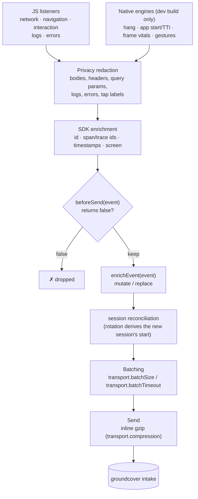
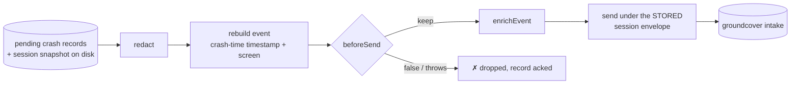

<p align="center">
  
</p>

<h1 align="center">RUM — React Native SDK</h1>

<p align="center">
  <a href="https://www.npmjs.com/package/@groundcover/react-native"></a>
</p>

groundcover's Real User Monitoring (RUM) SDK for React Native. It emits the same
`/json/rum` wire format as [`@groundcover/browser`](https://www.npmjs.com/package/@groundcover/browser),
so mobile sessions land in the same backend and dashboards as your web RUM.

The SDK captures sessions, network + distributed tracing, screen navigation, tap,
typing and gesture interactions, console logs, custom events and JS
errors/exceptions — with privacy masking **on by default**. On a dev build it
also captures **native crashes, ANR / app-hangs, app start + TTI and frame
vitals**.

> **Expo Go vs dev build.** Everything in the JS layer works in Expo Go with zero
> native setup. The four native features need a dev build (`expo run:ios` /
> `expo run:android`, or a bare RN app) — in Expo Go they simply never arm and
> the rest of the SDK is unaffected. See [Native features](#native-features).
> Throughout this README, a *dev build* means any build of your app with this
> package's native code compiled in, debug **or release** — as opposed to Expo Go.

> **Release candidate.** Session replay is not included.

See the [groundcover RUM documentation](https://docs.groundcover.com/investigate/real-user-monitoring-rum)
for the full product guide.

---

## Table of contents

- [Install](#install)
- [Migrating from 0.0.1-rc.0](#migrating-from-001-rc0)
- [Quick start](#quick-start)
- [Configuration reference](#configuration-reference)
- [Privacy & data masking](#privacy--data-masking)
- [What is captured](#what-is-captured)
- [Native features](#native-features)
- [Architecture](#architecture)
- [Coverage & limitations](#coverage--limitations)
- [Session persistence (AsyncStorage)](#session-persistence-asyncstorage)
- [Session lifecycle](#session-lifecycle)
- [Performance considerations](#performance-considerations)
- [API reference](#api-reference)

---

## Install

```bash
# npm
npm install @groundcover/react-native@rc

# yarn
yarn add @groundcover/react-native@rc

# pnpm
pnpm add @groundcover/react-native@rc

# Expo
npx expo install @groundcover/react-native@rc
```

> **Why `@rc`.** This is a release candidate, published under the `rc` dist-tag.
> Install with `@rc` to get the newest release candidate: until the first stable
> release, `latest` (what a bare package name installs) may point at an older one.

### Peer requirements

| Peer | Version | Required | Purpose |
|---|---|---|---|
| `react` | `>= 18.0.0` | ✅ | — |
| `react-native` | `>= 0.74.0` | ✅ | The supported floor. From 0.74 Hermes also ships the global `TextEncoder` the transport uses to encode emoji correctly; without one, batches are still sent but emoji are mis-encoded. See the [encoding note](#coverage--limitations). |
| `@react-native-async-storage/async-storage` | `>= 1.19.0` | optional | Session continuity across app restarts. See [Session persistence](#session-persistence-asyncstorage). |
| `@react-navigation/native` | `>= 6.0.0` | optional | Automatic screen tracking via `startNavigationTracking`. |

```bash
# optional — session continuity across app restarts:
npm install @react-native-async-storage/async-storage
# optional — automatic React Navigation screen tracking:
npm install @react-navigation/native
```

#### Supported vs tested

These are two different claims and the gap between them is real, so both are stated.
**Supported** is what the code requires — every API the native engines use sits at or
below these floors, and anything above them is version-guarded per feature.
**Tested** is what CI actually compiles and runs on a simulator or emulator every build.

| | Supported | Tested every build |
|---|---|---|
| React Native | `>= 0.74` | 0.86 (Expo 57, React 19.2) |
| iOS | 13.4+ | Simulator, latest stable Xcode |
| Android | API 23+ | Emulator, API 34 |

The untested span is not known-broken — it is unproven.
If you run the SDK below the tested row and hit something, it is worth reporting.

---

## Migrating from 0.0.1-rc.0

`0.0.1-rc.1` removes event-level sampling and fixes application identity for the lifetime of
each SDK instance, and `0.0.1-rc.2` matches `tracing.propagationUrls` against the full request URL.
These are breaking changes from `0.0.1-rc.0`:

```bash
npm install @groundcover/react-native@0.0.1-rc.7
```

| Change | Migration |
|---|---|
| `options.eventSampleRate` is removed | Delete it from initialization and runtime updates. Use `options.sessionSampleRate` to select whole sessions if needed. Rates are not automatically converted. |
| `appId` must be nonblank | Supply a non-empty, non-whitespace string. Its value is preserved exactly. Invalid initialization warns and does not start the SDK. |
| Each SDK instance initializes once | Initialize in your application's bootstrap code. Calls made during initialization or after success are silently ignored, including calls with the same app ID. Failed initialization permits retry. |
| `appId` cannot be updated | Exclude it from `updateConfig()`, including when spreading an initialization config. Its presence warns and rejects the entire update, even if its value is unchanged or `undefined`. |
| `tracing.propagationUrls` path patterns match nothing (`0.0.1-rc.2`) | Replace a path-only pattern such as `"/api/*"` with a full-URL one, e.g. `"https://api.myapp.com/*"`. A path pattern used to match that path on every host. |

If `eventSampleRate` was below `1`, event volume can increase: the removed option now warns and is
ignored. `sessionSampleRate` selects complete sessions; it is not an equivalent numeric replacement
for event sampling. Enabled-event settings, filtering, and privacy controls still apply.

Use `updateConfig()` for supported configuration changes, `identifyUser()` for identity updates,
and `setSessionId()` for session changes instead of calling `init()` again. To change the app ID,
storage backend, or enabled events, configure the next app launch with those values.

---

## Quick start

Call `init()` once (module top is fine), wrap your tree in `<GroundcoverProvider>`,
and wire navigation tracking to your `NavigationContainer` ref:

```tsx
import AsyncStorage from "@react-native-async-storage/async-storage";
import groundcover, { GroundcoverProvider } from "@groundcover/react-native";
import { NavigationContainer, useNavigationContainerRef } from "@react-navigation/native";

groundcover.init({
  apiKey: "your-rum-api-key",
  dsn: "your-rum-ingest-host.groundcover.com", // a bare host is upgraded to https://
  cluster: "your-cluster",
  appId: "my-app",
  environment: "production",
  releaseId: "1.0.0",
  // Persist session state across app restarts. Passing AsyncStorage explicitly is
  // recommended (and required in pnpm/monorepo setups where the bundler can't
  // resolve the SDK's own optional require). Omit it and the SDK auto-detects the
  // peer; without either, session state is memory-only (a fresh session each launch).
  storage: AsyncStorage,
  options: {
    // Send distributed-tracing headers to your own API hosts:
    tracing: { propagationUrls: ["https://api.myapp.com/*"] },
  },
});

export default function App() {
  const navigationRef = useNavigationContainerRef();
  return (
    <GroundcoverProvider>
      <NavigationContainer
        ref={navigationRef}
        onReady={() => groundcover.startNavigationTracking(navigationRef)}
      >
        {/* your app */}
      </NavigationContainer>
    </GroundcoverProvider>
  );
}
```

- **`init()` is fire-and-forget** and safe to call at module top. It returns
  immediately, hydrates storage asynchronously, and buffers API calls made
  before it's ready, replaying them in order once it is. The buffer holds the 100
  most recent calls; beyond that the oldest are dropped, with one warning.
  `getSessionId()` is not buffered — it returns `""` until the SDK is ready.
- **The first successful initialization wins.** A nonblank `appId` is required. Duplicate calls
  during hydration or after initialization are silently ignored without changing the session or
  configuration. If initialization fails, a later call can retry.
- **`<GroundcoverProvider>`** wraps the app to capture taps. It observes touches
  without claiming the responder, so it does not take touches from your components.
  One exception on iOS dev builds: see the
  [gesture-handler note](#coverage--limitations).
- **`startNavigationTracking(ref)`** turns each React Navigation screen change
  into a `navigation` event and stamps the current screen on every event. Call it
  from `onReady` (the ref is populated by then). expo-router users can pass its
  `useNavigationContainerRef()`.

From there, enrich the data:

```ts
groundcover.identifyUser({ id: "u_123", email: "user@example.com", organization: "acme" });
groundcover.captureException(new Error("Checkout failed"), { feature: "checkout" });
groundcover.logger.warn("Payment retry", { provider: "stripe", attempt: 2 });
groundcover.sendCustomEvent({ event: "plan_upgraded", attributes: { plan: "pro" } });
```

---

## Configuration reference

`init()` takes connection/identity fields at the top level (plus the RN-only
`storage`) and all behavioral knobs under `options`, grouped by concern.

```ts
groundcover.init({
  // ── Connection & identity ──
  apiKey, dsn, cluster, appId, environment,
  namespace, releaseId, user, sessionId,
  storage, // RN-only: AsyncStorage instance

  options: {
    debug,
    sessionSampleRate,
    sessionMaxDuration,
    enabledEvents, excludedUrls,
    appVersion, appBuild,
    beforeSend, enrichEvent,
    privacy:   { /* … */ },
    tracing:   { /* … */ },
    transport: { /* … */ },
    native:    { /* … */ },  // RN-only: native-feature tuning
  },
});
```

### Top-level (connection & identity)

| Field | Type | Required | Description |
|---|---|---|---|
| `apiKey` | `string` | ✅ | Your groundcover RUM API key. |
| `dsn` | `string` | ✅ | RUM intake host. A bare host is upgraded to `https://`. Avoid an explicit `http://` DSN: release builds block plain HTTP (Android has no cleartext permission outside debug, iOS App Transport Security refuses it), so no telemetry arrives. The SDK warns at startup when a non-debug build is configured this way. |
| `cluster` | `string` | ✅ | Target groundcover cluster. |
| `appId` | `string` | ✅ | Nonblank application identifier, fixed at initialization; reported as the service/app name. |
| `environment` | `string` | ✅ | Deployment environment (e.g. `production`, `staging`). |
| `namespace` | `string` | — | Logical grouping/namespace for the app. |
| `releaseId` | `string` | — | Release/version identifier (e.g. a semver or commit hash). |
| `user` | `object` | — | Identify the user at init (same fields as [`identifyUser`](#identifyuser)). |
| `sessionId` | `string` | — | Bind a specific session id at init (e.g. to share one across surfaces). |
| `storage` | AsyncStorage | — | AsyncStorage instance (or its module namespace) for cross-restart persistence. See [Session persistence](#session-persistence-asyncstorage). |
| `options` | `Partial<SDKOptions>` | — | Behavioral configuration, below. |

> Required fields are enforced by the `SDKConfigInput` type — code to it, because
> at runtime a missing field does not always fail loudly. A missing or blank
> `appId` warns and the SDK does not start. A missing `cluster` lets the SDK start
> and capture, but no batch is sent until a cluster is set (e.g. via
> `updateConfig`), and nothing says so unless `debug` is on. Other missing string
> fields fall back to `""`.

### `options` — top-level knobs

| Option | Type | Default | Description |
|---|---|---|---|
| `debug` | `boolean` | `false` | Verbose SDK console logging. |
| `sessionSampleRate` | `number` | `1` | Fraction of sessions captured (0–1). |
| `sessionMaxDuration` | `number` | `14400000` (4 h) | Target max session length in ms (1 min – 8 h). See [session lifecycle](#session-lifecycle). |
| `enabledEvents` | `RNEventName[]` | `[]` | Listeners to enable. **Empty = all.** Members: `"interaction"`, `"network"`, `"logs"`, `"navigation"`, `"exceptions"`, and the [dev-build-only](#native-features) `"crashes"`, `"hangs"`, `"appStart"`, `"vitals"`. |
| `native` | `NativeOptions` | — | Tuning for the [native features](#native-features): `hangThresholdMs` (250–60,000 ms), `vitalsMaxSegmentMs` (1,000–300,000 ms), `tti`. Out-of-range values fall back to the default. Enabling/disabling lives in `enabledEvents`. |
| `excludedUrls` | `Array<string \| RegExp>` | — | Network requests matching these are not captured. Strings support `*` / `?` globs; otherwise matched exactly. |
| `appVersion` | `string` | — | App version stamped on session attributes. See [App version stamping](#app-version-stamping). |
| `appBuild` | `string` | — | App build number stamped on session attributes. See [App version stamping](#app-version-stamping). |
| `beforeSend` | `(event) => boolean` | — | Drop gate — return `false` to discard an event. Receives dot-flattened attributes. See below. |
| `enrichEvent` | `(event) => event` | — | Mutate/replace an event before batching. Receives dot-flattened attributes. See below. |

#### `beforeSend` / `enrichEvent`

Both hooks receive the event with its attributes **dot-flattened** — the exact
shape the SDK puts on the wire. The SDK flattens every nested attribute object
before these hooks run, so a build-shape field like `interaction_target: { label }`
becomes the flat key `"interaction_target.label"`, and `url: { full }` becomes
`"url.full"`. **Read flattened fields with bracket keys** — nested access
(`event.attributes.url.full`) is `undefined` at runtime and would throw. The one
exception is the RN-stamped `screen` block, which stays nested and typed.
`event.type` still discriminates the seven kinds (`interaction`, `network`, `log`,
`navigation`, `custom`, `exception`, and `performance` for app start, TTI and frame
vitals), and the exported `CallbackEvent` /
`FlattenedEventAttributes` types annotate your own handlers.

`beforeSend` runs first (return `false` to drop), then `enrichEvent`:

```ts
import type { CallbackEvent } from "@groundcover/react-native";

options: {
  beforeSend: (event) => {
    // Attributes are FLAT — use bracket keys, not nested property access.
    if (
      event.type === "network" &&
      String(event.attributes["url.full"] ?? "").includes("/health")
    ) {
      return false; // drop noisy health-check network events
    }
    return true;
  },
  enrichEvent: (event) => {
    event.attributes.screen.name; // `screen` is the one block that stays nested + typed
    return event;
  },
}
```

Both hooks receive the already-redacted, enriched event.

#### App version stamping

`appVersion` / `appBuild` are stamped onto session attributes (`app.version` /
`app.build`; `app.id` comes from `appId`). Explicit values take precedence. When
either is omitted, the SDK reads it from **`expo-constants`** if that module is
installed (`expoConfig.version`, `ios.buildNumber`, `android.versionCode`). On bare
React Native (no `expo-constants`), pass `appVersion` / `appBuild` explicitly to
stamp them:

```ts
options: { appVersion: "1.4.0", appBuild: "142" }
```

### `options.privacy`

Data-masking config, **on by default**. See
[Privacy & data masking](#privacy--data-masking) for the full reference.

### `options.tracing`

Distributed-tracing header propagation for outgoing requests.

| Option | Type | Default | Description |
|---|---|---|---|
| `propagationUrls` | `string[]` | `[]` | Request URLs (`*`-glob or literal match against the full URL) that receive injected tracing headers. |
| `propagationHeaders` | `string[]` | `[]` | Header names to inject; falls back to `traceparent` when empty. |
| `traceIdHeaderName` | `string` | `""` | Additional header carrying the (decimal) trace id. |
| `spanIdHeaderName` | `string` | `""` | Additional header carrying the (decimal) span id. |
| `origin` | `{ name: string; value: string }` | `{ name: "", value: "" }` | Origin tag stamped on injected trace headers. |

```ts
options: {
  tracing: {
    propagationUrls: ["https://api.myapp.com/*"],
    // traceparent (W3C) is injected by default on matched URLs.
  },
}
```

> Only `*` is a wildcard in `propagationUrls`; every other character is matched
> literally. This is deliberate — an unescaped `.` would let trace headers (and
> your `origin` tag) leak to look-alike hosts.
>
> Patterns match the **full** request URL, host included. A path-only pattern
> such as `"/api/*"` matches nothing (the SDK warns once at startup): with no page
> origin to scope it to, it would send your trace headers to every host serving
> that path.

### `options.transport`

Batching and delivery of outgoing event batches.

| Option | Type | Default | Description |
|---|---|---|---|
| `batchSize` | `number` | `10` | Max events buffered before a batch flushes. |
| `batchTimeout` | `number` | `10000` | Max ms a batch waits before flushing regardless of size. |
| `compression` | `boolean` | `true` | Gzip-compress outgoing batches. |

> **RN gzip caveat:** some RN networking stacks (OkHttp) strip the request
> `Content-Encoding` header, so a gzipped batch can reach the intake unlabeled and
> fail to decode. If you see decode failures, set `transport: { compression: false }`
> to send plain JSON.

### Updating config at runtime

`updateConfig` mirrors the `init` shape with four exceptions, each enforced by
the `SDKConfigUpdate` type rather than left to documentation:

- **`appId` is dropped** — application identity is fixed at initialization. At runtime, any update
  containing `appId` warns and is rejected in full, even for sampled-out sessions.
- **`sessionId` is dropped** — session identity is not a config value; use
  [`setSessionId`](#getsessionid--setsessionid).
- **`storage` is dropped** — the backend is bound once at init and never rebound.
- **`options.enabledEvents` is dropped** — which signals are captured is fixed at
  `init`. Listeners are installed once and read their enablement then, and the
  native engines return their existing state from a second initialization rather
  than tearing anything down. Allowing the key would type-check a call that
  changes nothing, leaving you believing a signal was switched off while it keeps
  reporting. Choose the set at `init`.

A few options are accepted by `updateConfig` but are read when the SDK starts, so set
them at `init`: changing `options.sessionSampleRate` (the sampling decision is made at
startup) or anything under `options.native` at runtime has no effect, and
`options.debug` takes effect only partly.

Nested groups merge, so a partial update preserves the other keys in the group:

```ts
groundcover.updateConfig({
  options: {
    transport: { batchSize: 20 }, // batchTimeout/compression preserved
    privacy: { level: "mask-all" },
  },
});
```

For `user`, `updateConfig` additionally accepts `null` to **clear** the current
identity (e.g. on logout):

```ts
groundcover.updateConfig({ user: null });
```

---

## Privacy & data masking

Masking is **on by default** (`privacy.level: "mask-sensitive"`). A single `level`
is the master switch; finer toggles and a custom hook refine it.

| `level` | Network / logs / errors | Tap & input labels |
|---|---|---|
| `mask-sensitive` **(default)** | sensitive fields redacted (bodies, query params, headers, log & error fields) | captured (structural id + label) |
| `mask-all` | redacted | tap/input labels also masked |
| `allow` | off (but auth headers are still stripped — see below) | captured |

> **Auth headers are always stripped, even under `allow`.** `authorization`,
> `cookie`, `set-cookie`, and any header name matching `token` / `key` / `secret` /
> `passwd` / `password` / `auth` / `bearer` / `credential` are redacted at every
> privacy level.
>
> **Typed text is never captured at any level** — input interactions record only
> that a field was edited and its structural identity, never the value entered.

### Options

| Option | Type | Default | Description |
|---|---|---|---|
| `level` | `"mask-sensitive" \| "mask-all" \| "allow"` | `"mask-sensitive"` | Master masking switch. |
| `maskNetworkBodies` | `boolean` | `true`¹ | Redact network request/response bodies. |
| `maskNetworkQueryParams` | `boolean` | `true`¹ | Redact URL query params. |
| `maskLogs` | `boolean` | `true`¹ | Redact console/log messages and attributes. |
| `maskErrors` | `boolean` | `true`¹ | Redact error messages and metadata. Stack frames are sent as they are. |
| `sensitiveKeys` | `string[]` | — | Extra case-insensitive key substrings treated as sensitive, merged with the built-ins. |
| `redact` | `Redactor` | — | Per-leaf custom redactor for non-replay events (see below). |
| `maskInteractionLabels` | `boolean` | on only when `level: "mask-all"` | Mask tap/input labels + hints (accessibilityLabel / hint / value text). `role` / `component` / component path / `state` stay (structural). Setting it `true` masks labels at any level; `false` cannot unmask them under `"mask-all"`. |

¹ Each `mask*` toggle defaults **on** unless `level` is `"allow"`. Under `"allow"` they
are all off, and setting one to `true` does not turn it back on.

```ts
options: {
  privacy: {
    level: "mask-sensitive",
    sensitiveKeys: ["account_no"],
    maskInteractionLabels: true, // mask labels without going full mask-all
  },
}
```

#### Built-in sensitive patterns

These are always treated as sensitive (case-insensitive); your `sensitiveKeys` are merged in on top.

- **Key substrings** — matched as a substring of a body or query key:
  `token`, `secret`, `passwd`, `password`, `api_key`, `access_key`, `write_key`, `auth`, `bearer`,
  `credential`, `cvv`, `ssn`, `credit_card`, `card_number`. For `api_key`, `access_key`,
  `write_key`, `credit_card` and `card_number` the separator is flexible — absent, `_` or `-` all
  match, so `apikey`, `api_key` and `api-key` are equivalent. The rest match literally. Kept
  deliberately specific so a bare `card` or `session` doesn't swallow `cardinality` or
  `session_id`.
- **Request/response headers** — stripped at every `level`, including `"allow"`: `authorization`,
  `cookie`, `set-cookie`, plus any header name containing `token`, `key`, `secret`, `passwd`,
  `password`, `auth`, `bearer` or `credential`. Header names match a broader pattern than body keys,
  so a bare `key` substring still catches `x-api-key` and friends.
- **Query / form param names** — matched as a *whole* key and never inside JSON bodies, covering
  the OAuth authorization-code callback: `code`, `state`, `session_state`, `id_token`,
  `access_token`, `refresh_token`, `token`. Whole-key only because `code` and `state` legitimately
  mean an HTTP status and UI state inside a body.

To opt out entirely: `privacy: { level: "allow" }` — note this does *not* restore sensitive
headers, which are stripped at every level.

> **A custom [`redact`](#the-redact-hook) hook overrides all of the above.** Under
> `mask-sensitive` and `mask-all` it runs on every leaf — sensitive headers included — and any
> non-`undefined` return value replaces the built-in `[REDACTED]`. That is the point of the hook:
> each field arrives carrying a `sensitive` flag so you can decide. But it means a catch-all like
> `redact: (field) => field.value` silently un-redacts `authorization` and `cookie`. **Return
> `undefined` for anything you don't handle** and the built-in masking applies untouched. (Under
> `level: "allow"` the hook is not consulted for headers at all, so the built-in list still wins.)

### Per-element masking with `dataPrivate`

To mask a single element's interaction label/hint/value **even under the default
level**, add a truthy `dataPrivate` prop. The SDK's fiber walk detects it on the
tapped node **or any ancestor**, so tagging one wrapper masks its whole subtree.
Structural fields (`role`, `component`, component path, `state`) are unaffected.

```tsx
// Mask this control's label…
<Pressable dataPrivate accessibilityLabel="SSN 123-45-6789" onPress={…} />

// …or a whole region by tagging a wrapper (recommended — avoids passing an
// unknown prop to a host component):
<PrivateSection dataPrivate>
  <ProfileCard /> {/* every tap inside is masked */}
</PrivateSection>
```

### The `redact` hook

`redact` is called on **each leaf value** during the redaction walk (never on
objects/arrays — the SDK recurses those itself). Return a primitive replacement,
or `undefined` to defer to the SDK default (`sensitive ? "[REDACTED]" : value`),
so a hook that only cares about one field can't accidentally disable masking
elsewhere:

```ts
import type { RedactField } from "@groundcover/react-native";

options: {
  privacy: {
    redact: (field: RedactField) => {
      // field.key, field.value, field.path, field.kind, field.sensitive
      if (field.key === "email") return "[email]";
      return undefined; // fall back to SDK default
    },
  },
}
```

`field.kind` is one of `"request-body" | "response-body" | "query" | "header" |
"log" | "error"`.

### Apple privacy manifest

The iOS pod bundles a `PrivacyInfo.xcprivacy` (as `GroundcoverRum_Privacy.bundle`), so
App Store Connect's required-reason check (ITMS-91053) passes with no work on your side.
It declares:

- **Required-reason API:** file timestamps, `C617.1`, read only for the SDK's own crash
  records inside the app container. KSCrash's pods declare their own.
- **Collected data:** crash data, performance data, other diagnostic data and product
  interaction, plus user ID, email address and name if you pass them to
  [`identifyUser`](#identifyuser). All of it is marked as linked to the user, and none
  of it is used for tracking.

Xcode's privacy report (Organizer → Control-click an archive → **Generate Privacy
Report**) merges this with your app's other manifests. Use it as the starting point for your App Store privacy labels. Drop
email or name there if your app never sends them.

---

## What is captured

- **Sessions** — id, rotation on a 30-minute inactivity gap and the duration cap,
  driven by app foreground (`AppState`) and taps. Backgrounding flushes buffered
  events. Continuity across restarts requires AsyncStorage — see
  [Session persistence](#session-persistence-asyncstorage).
- **Network** — `fetch`, `XMLHttpRequest` and `axios`, with `traceparent` (and
  configurable) trace-header injection. Both `XMLHttpRequest` and the global
  `fetch` are wrapped, so classic RN and Expo's native-backed `fetch` are covered
  alike, with per-call gating so nothing is captured twice. Method,
  URL, headers, status, and request/response bodies (redacted, then capped at
  ~5 KB) are recorded. Textual response Blobs (RN's `fetch` polyfill) are read via
  `FileReader` with a 3s timeout; binary/form-data bodies become a placeholder
  (`[binary data]`, `[image data]`, `[form data]`, …).
- **Errors** — uncaught JS errors and errors reported via `captureException()`
  emit an `exception` event (type, message, parsed stack trace, fingerprint,
  handled flag, redacted metadata). Automatic capture hooks RN's global
  `ErrorUtils` handler and **chains the previous handler**, so the app's own
  crash/redbox behavior is untouched. **Unhandled promise rejections** are also
  captured as `exception` events with `handled: false` — see
  [Coverage & limitations](#coverage--limitations).
- **Navigation** — React Navigation screen changes (auto, via
  `startNavigationTracking`) or the manual `startNavigation` / `endNavigation`
  API. Route params are never captured (they often hold ids/tokens); pass anything
  you want recorded as metadata to the manual API.
- **Taps** — emitted as `interaction` events (`interaction_type: "tap"`) with a
  component path and a target describing the element: `component`, `label`
  (from `accessibilityLabel` / `aria-label` / text), `role`, `hint`
  (`accessibilityHint`), and — when present — `state` (`accessibilityState`) and
  `value` (`accessibilityValue`). Target quality depends on your accessibility
  hygiene.
- **Typing** — every `<TextInput>` is instrumented automatically (the SDK patches
  the component at init — no wrapper needed). Finishing an edit (blur / submit)
  emits ONE `interaction` event with `interaction_type: "input"`, labeled like a
  tap. The **typed value is never captured** — only that the field was edited and
  its structural identity.
- **Gestures** — swipes, scrolls, long presses and pinches are auto-captured as
  `interaction` events alongside taps, with the same target and component path.
  Each carries `interaction_gesture`: direction, distance, velocity, duration and
  pointer count. On a dev build the native tracker measures the movement (it sees
  a scroll through to its end, where the JS touch stream is cut short) and
  JavaScript supplies the labels; `interaction_gesture.capture_source` says which
  side measured it. Without the native module JavaScript handles everything, and
  a scroll Android cancelled mid-gesture is marked `partial` — its distance and
  velocity are lower bounds.
- **Logs** — captured `console.*` calls and the explicit `logger.*` API.
- **Custom events** and **user identification**.

Device metadata (`source: "mobile-rum"`, OS name/version, device model/brand,
screen dimensions, and app version/build) is stamped on session attributes.
`source` distinguishes mobile RUM from web; `os.name` (`"ios"` / `"android"`, or
`"other"` on a non-mobile host such as web/macOS) distinguishes the platform.

### Auto-captured vs manual

| Signal | Auto-captured | Manual API |
|---|---|---|
| Network requests | ✅ (XHR/fetch/axios) | — |
| JS errors (uncaught) | ✅ (`ErrorUtils`) | `captureException(error, metadata?)` |
| Unhandled promise rejections | ✅ (rejection tracker; release builds — see [limitations](#coverage--limitations)) | `captureException(...)` |
| Taps | ✅ (`GroundcoverProvider`) | — |
| Gestures (swipe/scroll/long-press/pinch) | ✅ (`GroundcoverProvider`) | — |
| Typing (input finished) | ✅ (patched `<TextInput>`) | — |
| Native crashes | ✅ (dev build) | — |
| ANR / app-hangs | ✅ (dev build) | — |
| App start | ✅ (dev build) | — |
| Time to interactive | ✅ (dev build) | `markAppInteractive()` |
| Frame vitals | ✅ (dev build) | — |
| Screen navigation | ✅ (`startNavigationTracking(ref)`) | `startNavigation` / `endNavigation` |
| Console logs | ✅ (`console.*`) | `logger.{log,info,warn,error,debug,trace}` |
| Custom events | — | `sendCustomEvent({ event, attributes })` |
| User identity | — | `identifyUser(user)` |

---

## Native features

Native crashes, ANR / app-hangs, app start + TTI and frame vitals are captured by
a native module that ships inside this package. It is autolinked — there is no
config plugin to add and no manual registration — but it has to be **compiled
into the app**, so it needs a dev build:

```bash
npx expo run:ios      # or: npx expo run:android
```

In a bare React Native app, install the iOS pod after adding the package — and again
after every upgrade — then rebuild. Android needs no extra step.

```bash
cd ios && pod install
```

In Expo Go there is no native module at all. The four features never arm, nothing
throws, and every JS feature above keeps working.

Each is a separate `enabledEvents` name, so you can keep crash reporting while
dropping frame vitals:

```ts
groundcover.init({
  // …
  options: {
    // Omit a name to turn that feature off. An empty array (the default) = all.
    // Here: everything except "vitals".
    enabledEvents: [
      "interaction", "network", "logs", "navigation", "exceptions",
      "crashes", "hangs", "appStart",
    ],
    native: {
      // Main-thread block before a hang is reported. Defaults to 2s on iOS and
      // 5s on Android — below Android's own 5s ANR bar there is nothing worth
      // reporting. Accepted range 250–60,000 ms; anything outside it (or not a
      // finite number) silently falls back to the default.
      //
      // A NUMBER APPLIES TO BOTH PLATFORMS. Prefer the per-platform object when
      // tuning, or a value chosen for iOS also replaces Android's 5s default
      // with a watchdog that fires below the platform's own bar:
      //   hangThresholdMs: 2_000                           // iOS AND Android 2s
      //   hangThresholdMs: { ios: 1_500, android: 8_000 }
      hangThresholdMs: { ios: 1_500 }, // Android stays 5s
      // Longest a frame-vitals segment may run before it is force-closed
      // (only used when "vitals" is enabled). Safety valve only — segments
      // normally end on a navigation or on backgrounding. Accepted range
      // 1,000–300,000 ms; anything outside it silently falls back to 60s.
      vitalsMaxSegmentMs: 60_000,
      // How "interactive" is decided for TTI. See below.
      tti: "auto",
    },
  },
});
```

### Crash delivery

A crash kills the JS runtime, so nothing can be sent as it happens. Native
persists the report along with a snapshot of the session, and the SDK sends it on
the **next launch, under the session it happened in** — not the fresh one.

Delivery is **at-least-once**: the record is kept until the upload is confirmed,
so a crash on a plane is reported when the app next runs with a network. A retry
can therefore deliver the same crash twice; `error_metadata.crash_report_id` is
stable across attempts, so a duplicate can be recognised.

On Android, ANRs and native (NDK) crashes are recovered from the system's own
exit records on API 30+. Below that the process is killed without a trace and
they are invisible.

#### When another crash reporter is present

A crash reporter with handlers of its own runs alongside this SDK. A reporter
that doesn't use KSCrash installs its own handlers and passes a crash on to the
reporter installed before it: both SDKs record the crash, and both report it.

A crash reporter built on KSCrash (its pod or Swift package depends on KSCrash)
is different. On iOS, native crash capture uses KSCrash, which is a
**process-wide singleton**. If that reporter installs first, this one does not
take it over: reading its store would delete its reports before they had been
sent. Native crash capture is then unavailable for the session, and the SDK logs
a warning saying so:

```
[groundcover] native crash capture is unavailable: <reason>. Native crashes will
not be reported for this session.
```

Every other signal — JS errors, hangs, app start, vitals, gestures, network — is
unaffected. If this SDK installs first, the other reporter can't capture
crashes, and it may delete this SDK's unsent crash reports when it reads the
store they share. Keep one of the two for iOS crashes: start the other reporter
before this SDK, or leave its crash reporting out. On Android the SDK chains onto
whatever handler it finds, so a second reporter is the normal case and needs
nothing.

### Querying hangs: `error_type` differs per platform

A main-thread stall is one product concept with two platform names, and the SDK
reports each platform's own:

| Platform | `error_type` | `error_message` |
|---|---|---|
| Android | `ANR` | `Main thread blocked for 3003ms` |
| iOS | `AppHang` | `Main thread blocked for 3101ms` |

This is deliberate. `ANR` is Android's own term and what its docs, Play Console
and tooling use; `AppHang` is Apple's. Either name is what an engineer on that
platform would actually type into a search box, and collapsing them to one would
make hangs harder to find in the case that matters most — someone debugging a
specific platform.

**So a query for one of them finds half your hangs.** Match both:

```
error_type IN ("ANR", "AppHang")
```

Both Android paths use `ANR` — the live watchdog and the ANRs recovered from
`ApplicationExitInfo` — so the pair above covers every hang from both platforms.
Tell the two apart with `error_metadata.recovered`: `true` for a stall the app came
back from, `false` for one the process never returned from.

### What the live watchdogs can and cannot see

Both platforms detect a stall by asking the main thread whether it is still
answering, on a fixed cadence — so the threshold is a floor, not an exact
boundary. A stall is reported reliably once it exceeds the threshold plus one
check interval: **0.5s on Android; on iOS a fifth of the threshold, between
0.1s and 1s** (0.4s at the 2s default). Between those two points detection
depends on where the stall falls relative to a check, so a stall of almost
exactly `hangThresholdMs` may or may not arrive.

`error_metadata.hang_duration_ms` is measured from the main thread's last
heartbeat before the stall: every 0.5s on Android, every 0.1s on iOS. Durations
therefore err slightly **long**, by at most one heartbeat, and never short.

Neither number needs tuning for the defaults to work: Android's 5s default
reliably reports anything past 5.5s, well below the ~10s at which users abandon
an app, and iOS's 2s default reports anything past 2.4s.

Native crash types diverge for a stronger reason and are not unified either: a
`java.lang.IllegalStateException` and an `EXC_BAD_ACCESS` are genuinely different
things, not two names for one.

### Frame vitals

Frame vitals are captured **per screen**, not on a timer. Native counts every
frame the display produced and holds one open *segment*; the segment closes — and
becomes one `performance` event — when one of three things happens:

| `performance_segment_reason` | when |
|---|---|
| `navigation` | the user left the screen |
| `background` | the app left the foreground |
| `safety` | the segment ran longer than `vitalsMaxSegmentMs` (60s) |

A segment closed by a navigation is attributed to the screen being **left**, not
the one arrived at — the frames were drawn there. Consecutive `safety` segments
followed by a `navigation`/`background` one can be summed to recover a whole
screen's totals.

**Vitals stop while the session is idle.** A closed segment is reported only while
the session is still active. Thirty minutes with no presence signal — a tap,
gesture or keystroke, or the app returning to the foreground — and segments are
dropped rather than sent; the next presence signal resumes them. This is
deliberate: the `safety` close fires on elapsed time alone, so an app left
foregrounded with nobody using it would otherwise report frame timings for an
untouched screen indefinitely, and session duration is derived from the last
event. Expect a gap in `performance` events across any idle stretch — it means
nobody was there, not that vitals stopped working.

Each closed segment emits ONE event, `frames_delay_total`:

| metric | unit | meaning |
|---|---|---|
| `frames_delay_total` | **milliseconds** | how much time the user spent waiting — every slow frame's duration beyond the frame budget, summed. Absolute, not a rate. The `_total` is load-bearing: the value is the whole segment's lost time, not one frame's, so quantiling it is not "how long a frame took". |

It carries:

| attribute | meaning |
|---|---|
| `performance_refresh_rate_hz` | the display's **nominal** rate — what the panel can do. **Not** the bar `slow` was judged against; see the next row. |
| `performance_frame_budget_ms` | the budget each frame was actually measured against. On an adaptive (ProMotion) panel iOS judges against the cadence the display is *really* running at, so an idle 120Hz screen has a ~16.7ms budget while the nominal rate implies 8.33ms. Ships so you can reproduce `performance_frames_slow` and `frames_delay_total` from the wire. |
| `performance_segment_reason` | one of the three reasons above |
| `performance_frames_slow` / `_frozen` | the raw counts — absolute, and comparable across platforms |
| `start_timestamp` / `end_timestamp` | segment bounds, epoch nanoseconds |
| `screen` | the screen the frames were drawn on |

`frames_delay_total` is the one to sort screens by: it says how much of the
user's time went missing, which is what you want when deciding what to fix.
Normalize it by the segment bounds — milliseconds lost per second of screen time
— and the number is comparable across platforms.

#### Why there is no slow-frames *rate*

The SDK ships absolute slow and frozen **counts**, and deliberately no slow-frames
rate, frame total or refresh-rate metric. The two platforms do not count the same
thing:

- **Android** counts only frames it actually **drew** (`FrameMetrics` fires on a
  real draw). An idle screen draws nothing.
- **iOS** counts every **display refresh** (`CADisplayLink` ticks whether or not
  the app drew).

So a `slow / total` ratio, or an average frame rate, would mean different things on
each platform: seconds spent reading a still screen would dilute iOS's number while
leaving Android's untouched. A slow frame, by contrast, is a slow frame on both.

**Normalize the counts by TIME.** `start_timestamp` and `end_timestamp` ship on
every segment, and a second is a second on both platforms:

```
slow frames per minute = performance_frames_slow / ((end_timestamp - start_timestamp) / 6e10)
```

A frame is **slow** past `1000 / (refreshRate - 1)` ms — one frame interval, with
a vsync's worth of tolerance.
Relative to the display rather than a fixed 16.7ms, so a stuttering 120Hz device
is not reported as healthy. **Frozen** is a frame over 700ms, and is a subset of
slow.

A screen that renders nothing produces no frames on Android, so its segment can
be empty — an empty segment is not reported at all, which keeps "0 frames
measured" distinguishable from "0% slow".

A `background` segment is **closed** when the app leaves the foreground but is
usually **delivered** on the way back in: the SDK flushes its queue from the
AppState handler, and the native signal crosses the bridge just after that, so
the pair lands in a pool that has already been emptied. Nothing is lost — it
ships with the next batch.

### App start

Each app start is reported as one `performance` event, with the duration in
milliseconds as `performance_metric_value` and the kind in
`performance_metric_name`:

| `performance_metric_name` | measured | from → to |
|---|---|---|
| `app_start_cold` | a launch that started the process | process start → first frame |
| `app_start_warm` | **Android only** — an Activity recreated rather than freshly launched: the system had torn the UI down while the process lived, or the launch restored saved state | Activity creation → first frame |
| `app_start_hot` | a return to the foreground with the UI still intact | foreground transition → next frame |
| `app_start_tti` | time to interactive, once per cold start — see [below](#time-to-interactive) | cold-start anchor → interactive |

`performance_metric_navigation_type` carries the start kind (`cold`, `warm`, `hot`).
On iOS a launch the system prewarmed is still an `app_start_cold`, measured from
when the app's code loaded rather than from process start (which may have been
minutes earlier), with `cold_prewarmed` as its navigation type. iOS reports no warm
starts, and does not report a launch that went to the background before drawing its
first frame. On Android, a first launch whose Activity is created more than 10
seconds after the process started is reported as warm. On both platforms a start
longer than 60 seconds is discarded as implausible.

The event waits up to 5 seconds for the first screen to land, so it is attributed to
the screen the user arrived on.

### Time to interactive

TTI measures from the cold-start anchor to the moment the app became **usable**,
and only JavaScript knows when that is. It is never reported as shorter than the
cold start itself, and only for cold starts.

- `tti: "auto"` (default) — the first screen landing. Honest as a *floor*: it
  fires before that screen's own data has loaded.
- `tti: "manual"` — you decide. Set it at `init`, then call
  `groundcover.markAppInteractive()` once, when the first screen is genuinely ready:

```ts
groundcover.init({
  // …
  options: { native: { tti: "manual" } },
});
```

```ts
// …then, after your first screen's data has actually arrived:
groundcover.markAppInteractive();
```

The timestamp is taken at the call, even before `init()` has finished, so it is
never distorted by SDK startup.

---

## Architecture

Every captured event flows through one pipeline from capture to intake. The two public hooks —
**`beforeSend`** (drop gate) and **`enrichEvent`** (transform) — run just before an event is
batched, *after* privacy redaction and the SDK's own enrichment, so they see the final,
already-redacted event.

> **Except for `sendCustomEvent`.** Custom-event payloads are deliberately *not* auto-redacted —
> they are values you supplied on purpose. `enrichEvent` is the documented place to scrub them.

Unlike the browser SDK, there are **two capture sources**: the JavaScript listeners, and — on a dev
build — the native engines. Both converge on the same redaction and enrichment path.

> **Native crashes are not on this diagram.** A crash is not a live signal — there is no runtime
> left to emit one. It is persisted by native and replayed on the next launch down a separate path
> that bypasses the live pipeline. See
> [Crash reporting takes a different path](#crash-reporting-takes-a-different-path).



**Event lifecycle (in order):**

1. **Capture** — a JS listener builds the raw event, or a native engine emits a signal.
2. **Redact** — sensitive payload is masked per the resolved [`privacy`](#privacy--data-masking) config.
3. **Enrich (internal)** — the SDK stamps id / span & trace ids / timestamps / `screen`.
4. **`beforeSend(event)`** — your hook; return `false` to **drop** the event. Receives the
   fully-redacted, enriched event with [dot-flattened attributes](#beforesend--enrichevent).
5. **`enrichEvent(event)`** — your hook; mutate or replace the event before it is buffered. A
   return value that isn't a usable event **drops** it rather than falling back to the original —
   the original is exactly what a failed scrubber was supposed to remove. (On the crash path this
   one differs: it falls back instead of dropping — see
   [below](#crash-reporting-takes-a-different-path).)
6. **Reconcile** — the *final* event drives session reconciliation. This runs after `enrichEvent`
   on purpose: a rotation derives the new session's start time from the event, and a hook that
   moved a timestamp earlier than the pre-enrichment value would ship an event predating the very
   session it opened.
7. **Batch** — buffered and flushed on `transport.batchTimeout`, on
   backgrounding, and on reaching `transport.batchSize` — except for `navigation`, `interaction`
   and `performance` events, which never trigger the size flush on their own. A buffer holding
   only those (taps and screen changes, the common mobile case) ships on the timeout instead.
8. **Send** — gzipped (`transport.compression`) and delivered to intake.

Which listeners exist is decided once, at `init`, by [`enabledEvents`](#options--top-level-knobs).
In Expo Go the native module is absent, so the native branch of the diagram simply doesn't exist.

> **No Web Worker.** React Native has none, so gzip runs inline on the JS thread rather than being
> offloaded as it is in the browser SDK. See [Performance considerations](#performance-considerations).

### Crash reporting takes a different path

A native crash cannot be reported in the session it happened in — the process is gone. Native
writes the crash record and a snapshot of the session envelope to disk; on the **next launch** the
SDK reads them back and rebuilds the event with the crash-time timestamp and the crash-time
screen.

That path **bypasses the live batching pipeline**, so it applies the two public hooks itself — otherwise a
host's `beforeSend` / `enrichEvent` would silently never run for crashes:



Three things differ from the live path, deliberately:

- **It sends under the stored session envelope**, not the current one, so the crash is attributed
  to the session it happened in. Session sampling applies implicitly: an unsampled session never
  had a snapshot pushed in the first place.
- **Both hooks are contained, with different answers on failure.** A throwing `beforeSend` acks
  the record and drops it, matching the live path, which drops an event whose `beforeSend`
  throws — not acking would retry a permanently broken callback on every launch forever, and the
  pending directory is capped. A throwing `enrichEvent` costs only its added attributes; the crash
  report itself still ships.
- **An unusable `enrichEvent` return falls back rather than drops.** The live path drops such an event;
  this path cannot, because a fatal is the most valuable event the SDK sends — and it does not need
  to, because the crash event was already redacted when it was built, so there is nothing
  unscrubbed to protect against. The return is still *validated*: a hook that returns a truthy
  non-event (`{}` from an untyped caller, or an arrow with an implicit return) is ignored and the
  built crash report ships unchanged.

Delivery is at-least-once with a stable `crash_report_id`, so a duplicate can be recognised.

---

## Coverage & limitations

Session replay is not included.

- **Network capture wraps both transports.** Classic RN routes `fetch` through
  `XMLHttpRequest`, but Expo replaces the global `fetch` with a native-backed
  implementation that never touches XHR — so the SDK wraps **both** `XMLHttpRequest`
  and `globalThis.fetch`, and gates each call so a request travelling through both
  is captured once, not twice.
  - **A direct `import { fetch } from "expo/fetch"` is not captured.** The wrapper
    is installed on the *global* `fetch`, which under Expo already is the
    native-backed implementation. Importing the binding straight from the module
    bypasses the global and escapes capture — use the global `fetch` for requests
    you want traced.
- **Unhandled promise rejections are captured in release builds** as `exception`
  events (`handled: false`) via the engine's rejection tracker — Hermes'
  `enablePromiseRejectionTracker`, or RN's bundled `promise` polyfill on
  JavaScriptCore. The engine exposes a **single** tracker slot.
  - **Caveat — Hermes debug builds:** React Native installs its *own*
    rejection tracker at startup, but **only in `__DEV__`** (see RN's
    `Libraries/Core/polyfillPromise.js`). In a debug build rejections surface
    through RN's default "Possible Unhandled Promise Rejection" warning rather
    than a groundcover `exception`. In **release builds** RN does not install it,
    so the SDK's tracker is active and rejections are captured. Confirm it in
    your own release build. The JavaScriptCore path always uses the SDK's tracker.
  - **Gated by the `"exceptions"` signal — together with all JS error capture.**
    Rejection capture is installed only when exceptions are enabled — i.e.
    `enabledEvents` is empty (all signals) or includes `"exceptions"`. Leaving
    `"exceptions"` out frees the engine slot for another library, but it also
    turns off uncaught-error capture through `ErrorUtils` and makes
    `captureException` a no-op: all three share the one signal.
  - **Compatibility — the tracker slot is engine-wide and shared.** Because the
    engine exposes a single slot, enabling exceptions makes the SDK the app's
    rejection tracker. If another error/RUM SDK or a library also installs one,
    only one of them receives rejections; don't run two. If you already rely on
    your own rejection tracker, the only opt-out is the `enabledEvents` one above,
    at the cost it describes. Integrators upgrading from the RN default dev warning
    should expect it to be replaced by groundcover `exception` events in release
    builds; verify with `enabledEvents` both including and excluding
    `"exceptions"` in debug and release.
  - The `ErrorUtils` global handler (uncaught errors) is always chained, never
    replaced: the app's previous handler still runs.
- **No session replay.** Mobile replay is native view-hierarchy capture, a
  separate engine from the web SDK's, and this SDK does not include it.
- **react-native-gesture-handler before 2.13 can lose drags on iOS dev builds.**
  To measure scrolls and swipes, the native module adds an observing pan
  recognizer to each window. It never cancels or delays touches, but it does
  activate once a drag passes the movement threshold, and gesture-handler before
  2.13 cancels the drag's JavaScript responder when any recognizer activates.
  Taps are unaffected. Upgrade gesture-handler to 2.13 or later.
- **One groundcover SDK per app.** A native app with React Native screens
  (brownfield) can't also run groundcover's native iOS or Android SDK: each would
  start its own crash reporter and session.
- **Native features need a dev build.** In Expo Go the native module is absent, so
  crashes, hangs, app start / TTI and frame vitals never arm — every JS feature is
  unaffected. See [Native features](#native-features).
- **Native crash stacks are not symbolicated server-side.** iOS frames are
  symbolicated on-device where possible; app frames in a stripped release build
  arrive as the image and the offset into it (`MyApp + 0x2334`), which the build's
  dSYM resolves. The binary's UUID and load address are recorded too, so each frame
  can be matched to the right dSYM — keep each release's dSYMs to read them. Android
  JVM stacks are readable as-is, except in an app minified with R8 / ProGuard,
  where your own classes and methods arrive under their obfuscated names — keep
  each release's `mapping.txt` to read them.
- **Android sees ANRs and NDK crashes only on API 30+**, where the system keeps
  exit records. Below that the process is killed without leaving a trace.
- **Android frame vitals need API 24+.** They ride `FrameMetrics`, which does not
  exist below that; on API 23 the tracker simply does not arm, since a wrong number
  would be worse than none. Every other native feature honours the API 23 floor.
- **Expo Go** runs every JS feature with zero native setup.
- **Emoji survive the wire only where the engine has a global `TextEncoder`**
  — Hermes from RN 0.74. The transport encodes each batch with the compression
  library's `strToU8`, which uses that global when it exists. Without it — JSC at
  any version, or an older Hermes — batches are **still sent**, through the
  library's own encoder, which gets astral-plane characters wrong: `🎉` goes out
  as `F0 9D AE 89` instead of `F0 9F 8E 89`. Every emoji in a screen name, log
  line or captured body would arrive corrupted, and nothing would fail loudly to
  say so. BMP text (accented Latin, Hebrew, CJK) is encoded correctly either way. Network **capture** is unaffected regardless — body
  sizing uses a separate hand-rolled byte counter that is correct on any engine.

---

## Session persistence (AsyncStorage)

Session state (the current session id, activity clock, and sampling verdict) is
persisted through AsyncStorage so a session survives app restarts. AsyncStorage is
an **optional peer** (`>= 1.19.0`); there are two ways to wire it, and one degrade
path:

1. **Inject explicitly (recommended)** — pass the AsyncStorage default export to
   `init({ storage })`:

   ```ts
   import AsyncStorage from "@react-native-async-storage/async-storage";
   groundcover.init({ /* … */, storage: AsyncStorage });
   ```

   This is the **reliable** path. In a **pnpm / monorepo / workspace** setup the
   bundler often can't resolve the SDK's own optional `require` of the peer, but
   the app always can — so explicit injection is required there.

2. **Auto-detect** — omit `storage` and the SDK attempts to `require` the peer
   itself. Convenient for a plain single-package app; fragile in monorepos (see
   above).

3. **Memory-only degrade** — if the peer is absent, hydration fails, or it exceeds
   the 3s hydration budget, the SDK runs **memory-only**: telemetry works
   normally, but each launch starts a **fresh session** (no cross-restart
   continuity). A missing peer is reported with a warning; a failed or timed-out
   hydration is logged only when `debug` is on. The SDK never throws over storage.

`init({ storage })` accepts either the AsyncStorage instance or its module
namespace (`{ default: AsyncStorage }`), so both `import AsyncStorage from …` and
`import * as AsyncStorage from …` work.

---

## Session lifecycle

`sessionMaxDuration` sets a **target** maximum wall-clock session length (default
4 hours / `14400000` ms; must be between 1 minute and 8 hours — out-of-range or
invalid values fall back to the default with a `console.warn`).

Rotation is **activity-gated, not timer-driven** — so the cap is not a hard upper
bound:

- Once the cap has elapsed, the *next* qualifying event flushes pending events
  under the current session id, mints a fresh id, and resumes tracking. An idle or
  backgrounded app that produces no events keeps its id past the cap until
  activity resumes.
- Sessions are also bounded by a **30-minute inactivity gap**, enforced the same
  lazy way: when activity resumes after 30+ minutes of silence, the session
  rotates first. The same gap check runs at init, so a cold launch after a long
  break also starts a fresh session.
- The flush is best-effort; rotation always proceeds regardless of delivery
  success.

**A session is confirmed by the user.** A new session sends nothing until the
user shows up: a touch inside `<GroundcoverProvider>`, a native gesture or a
finished text edit (those two need `"interaction"` enabled), or a return to the
foreground. Until then up to 500 events are held, the newest dropped past that,
so an error or custom event from before the first touch arrives once the session
is confirmed. A session that rotates before anyone confirmed it is discarded with
its buffer.

`getSessionId()` returns the current id — `""` before the SDK is ready, and for a
session that `sessionSampleRate` left out. `setSessionId(id?)` flushes buffered
events and rebinds the session id (passing no argument mints a fresh one); it
returns a `Promise` that resolves once the rebind settles, and does nothing in a
session that was not sampled.

**When a rotated session starts.** A new session's `session_start_time` is taken
from the earliest event that belongs to it — normally the event that triggered the
rotation — rather than from the instant the rotation ran. Using the later value
would report a session as starting *after* an event it carries, which reads
downstream as a negative duration. Candidates are only accepted if they are no
older than one inactivity window and not in the future, so a `beforeSend` /
`enrichEvent` hook returning a wildly skewed timestamp cannot move a session's
start (that value also drives the cap and inactivity clocks).

All of this assumes `cluster` is set: without it, the flushes described here send
nothing and events wait in the buffer — see
[Top-level](#top-level-connection--identity).

---

## Performance considerations

- **Batching & compression** — events are buffered (`transport.batchSize` / `transport.batchTimeout`)
  and gzipped (`transport.compression`), so the SDK makes few requests with small payloads. The SDK
  also flushes when the app is backgrounded, rather than holding a batch until the next launch.
- **Gzip runs inline** — React Native has no Web Worker, so compression happens on the JS thread
  instead of being offloaded as it is in the browser SDK. This is the one place the SDK does
  measurable work on your thread; the default batch sizes are set so it stays small, and raising
  `transport.batchSize` substantially trades request count against a longer single compression.
- **Sampling** — cap volume with `sessionSampleRate`, which selects complete sessions. Events
  within a selected session remain subject to the configured capture controls and `beforeSend`.
- **Scope what you capture** — drop noisy endpoints with `excludedUrls`, and disable what you don't
  need via `enabledEvents`. Each native signal is independently switchable (`"crashes"`, `"hangs"`,
  `"appStart"`, `"vitals"`), so you can keep crash reporting while turning frame vitals off.
- **Native watchdogs are cheap but not free** — hang detection is a background watchdog thread
  (default threshold 2s on iOS, 5s on Android); the only main-thread work is a tiny heartbeat, ten
  times a second on iOS and twice a second on Android, which pauses while the app is in the
  background. Frame vitals ride the
  platform's existing callback (`CADisplayLink` / `FrameMetrics`) and aggregate natively, emitting
  one event per screen segment rather than on a fixed cadence — `native.vitalsMaxSegmentMs`
  (default 60s) is a safety valve, and lowering it increases event volume while fragmenting a
  screen's stats.
- **Lazy session rotation** — no background timers; rotation work happens only on real activity.
- **Bundle size** — ships ESM + CJS with built-in types. The published bundle is **minified and
  has no sourcemaps**, the same as `@groundcover/browser`, so a stack frame inside the SDK points
  into the minified file rather than at readable SDK source. Frames in your own code are unaffected.

---

## API reference

All methods are on the default export.

| Method | Description |
|---|---|
| `init(config)` | Initialize once with a nonblank `appId` (async, fire-and-forget). Duplicate calls are silently ignored; failures allow retry. |
| `identifyUser(user)` | Attach user identity to the session and subsequent events. |
| `updateConfig(partial)` | Update options / user at runtime (merges nested groups). Cannot change `appId`, `sessionId`, `storage` or [`enabledEvents`](#updating-config-at-runtime); `sessionSampleRate` and `native` only take effect at `init`, and `debug` only partly at runtime. |
| `sendCustomEvent({ event, attributes })` | Emit a custom business event. |
| `captureException(error, metadata?)` | Report a handled error as an `exception` event. |
| `logger.{log,info,warn,error,debug,trace}(message, attributes?)` | Structured logging. |
| `getSessionId()` | Read the current session id (`""` before ready, or when the session is not sampled). |
| `setSessionId(id?)` | Flush and rebind the session id (returns a `Promise`). |
| `startNavigation(meta?)` / `endNavigation(meta?)` | Manual screen tracking (when auto is disabled). |
| `startNavigationTracking(ref)` / `stopNavigationTracking()` | Automatic React Navigation tracking. |
| `markAppInteractive()` | Mark the app usable, for [TTI](#time-to-interactive) in `tti: "manual"` mode. |

Manual APIs follow `enabledEvents`: when a signal is left out, its manual API does nothing.
`captureException` needs `"exceptions"`, `logger.*` needs `"logs"`, and `startNavigation` /
`endNavigation` / `startNavigationTracking` need `"navigation"`.

The package also exports the `GroundcoverProvider` component and the types
`SDKConfigInput`, `SDKConfigUpdate`, `SDKOptions`, `NativeOptions`,
`PrivacyOptions`, `PrivacyLevel`, `RedactField`, `RedactKind`, `Redactor`,
`EventTypes`, `RNEventName`, `RNSessionAttributes`,
`InteractionEventAttributes`, `AppStartMetricName`, `ScreenAttributes`,
`CallbackEvent`, `FlattenedEventAttributes`, `GroundcoverProviderProps`, and
`NavigationContainerRefLike`.

### `identifyUser`

```ts
groundcover.identifyUser({
  id: "u_123",
  email: "user@example.com",
  organization: "acme",
});
```

User fields (all optional): `id`, `email`, `name`, `role`, `organization`
(strings), and `properties` (an object of your own attributes).

### `captureException`

```ts
groundcover.captureException(new Error("Payment failed"), {
  userId: "u_123",
  feature: "checkout",
});
```

Emits an `exception` event with `handled: true`. Metadata is redacted per your
privacy config.

`captureException` accepts any value, not only an `Error`, and describes it as
`@groundcover/browser` does. A string or number becomes the message. An object is described by its
shape, never its values, so captures of the same kind group as one issue:
`Object captured as exception with keys: code, reason`, the class name for a class instance, or an
item count for an array. The value itself is sent in `error_metadata.captured_value` as JSON,
redacted field by field and cut at 10,000 characters. An object with a string `message` keeps its
own name, message and stack:

```ts
groundcover.captureException("Payment failed");
groundcover.captureException({ code: 500, reason: "timeout" });
```

Pass an `Error` when you can: a value that isn't one carries no stack trace of its own, so the
reported stack starts inside the SDK.

### `logger.*`

One method per level; the second arg is a structured attributes object:

```ts
groundcover.logger.warn("Checkout failed", { orderId: "ord_42", attempt: 2 });
groundcover.logger.error("Payment error", { provider: "stripe" });
```

### `sendCustomEvent`

```ts
groundcover.sendCustomEvent({
  event: "plan_upgraded",
  attributes: { plan: "pro", seats: 5 },
});
```

### Navigation

Automatic — wire the React Navigation ref once (see [Quick start](#quick-start)):

```ts
groundcover.startNavigationTracking(navigationRef);
// later, to stop:
groundcover.stopNavigationTracking();
```

Manual — when you don't use React Navigation, or auto-tracking is disabled:

```ts
groundcover.startNavigation({ screen: "Checkout" });
// …
groundcover.endNavigation({ screen: "Checkout" });
```

`startNavigation` makes the screen current, named by the `screen` (or `name`) string
in its metadata, with an optional `key`. `endNavigation` then emits one `navigation`
event carrying the time since `startNavigation` and both calls' metadata merged
(sensitive keys redacted unless the privacy `level` is `"allow"`). Nothing is emitted without a preceding
`startNavigation`, or when no screen name was given.

### `getSessionId` / `setSessionId`

```ts
const id = groundcover.getSessionId();      // "" before ready
await groundcover.setSessionId("my-id");    // flush + rebind
await groundcover.setSessionId();           // flush + mint a fresh id
```

